# VN Traffic AI — Sổ tay kỹ thuật toàn tập

**Mục đích**: Đọc 1 lần hiểu toàn bộ project — từ data pipeline, model architecture, training algorithm, runtime pipeline, đến code map clickable.

**Project**: Phát hiện + đếm phương tiện giao thông Việt Nam (4-class: motorcycle, car, bus, truck) bằng YOLOv8s + ByteTrack + line counting + Streamlit UI.

**Last update**: 2026-10-24.

---

## Mục lục

1. [Tổng quan kiến trúc](#1-tổng-quan-kiến-trúc)
2. [Dataset — thu thập + canonicalization](#2-dataset)
3. [Mô hình YOLOv8s — kiến trúc chi tiết](#3-mô-hình-yolov8s)
4. [Training pipeline — bên trong 1 epoch](#4-training-pipeline)
5. [Optimizer + Loss function](#5-optimizer--loss-function)
6. [Fine-tune evolution V1 → V2 → V3](#6-fine-tune-evolution)
7. [Evaluation methodology](#7-evaluation-methodology)
8. [Runtime pipeline (inference)](#8-runtime-pipeline-inference)
9. [Tracking — ByteTrack](#9-tracking--bytetrack)
10. [Counting — line crossing math](#10-counting--line-crossing-math)
11. [Streamlit UI](#11-streamlit-ui)
12. [Code map — mở file nào xem gì](#12-code-map)
13. [Phụ lục: Khái niệm cốt lõi](#13-phụ-lục-khái-niệm-cốt-lõi)

---

## 1. Tổng quan kiến trúc

Hệ thống có **2 pipeline song song**:

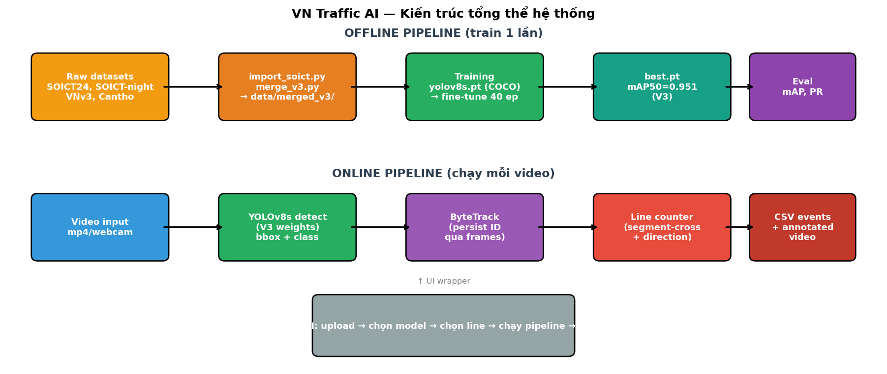

### 1.1 Offline pipeline (chạy 1 lần)

Xử lý dataset → fine-tune model → được trọng số `best.pt` dùng cho runtime.

| Bước | Code | Output |
|---|---|---|
| Import SOICT, VNv3, Cantho | [scripts/data_prep/import_soict.py](../../scripts/data_prep/import_soict.py), [import_vnv3.py](../../scripts/data_prep/import_vnv3.py), [import_cantho_vn.py](../../scripts/data_prep/import_cantho_vn.py) | `data/raw_soict_canonical/`, etc. |
| Merge + remap canonical | [scripts/data_prep/merge_v3.py](../../scripts/data_prep/merge_v3.py) | `data/merged_v3/` + `data/data_v3.yaml` |
| Train YOLOv8s | [scripts/training/v3_vn_only.py](../../scripts/training/v3_vn_only.py) | `runs/detect/train_v8s_v3_baseline/weights/best.pt` |
| Eval mAP, PR, confusion matrix | [scripts/evaluation/eval_coco_vs_v3.py](../../scripts/evaluation/eval_coco_vs_v3.py) | `results/tables/*.json`, charts |

### 1.2 Online pipeline (chạy mỗi video)

Nhận video → detect từng frame → track qua các frame → đếm khi qua line → export CSV + video annotated.

| Bước | Code | Output |
|---|---|---|
| Load video + model | [src/tracking/track.py](../../src/tracking/track.py) | Stream frames có bbox + tracking ID |
| Line counting | [src/tracking/counter.py](../../src/tracking/counter.py) | `events` list, `counter.counts` |
| Overlay + export | [src/pipeline/run.py](../../src/pipeline/run.py) | `*.mp4` annotated + `*.csv` events |
| UI | [ui/streamlit_app.py](../../ui/streamlit_app.py) | Web interface |

---

## 2. Dataset

### 2.1 Nguồn dữ liệu (3 nguồn VN + 1 TQ)

| Nguồn | Loại | Ảnh | Role trong V3 |
|---|---|---|---|
| **SOICT2024** (Roboflow) | VN, giao thông ngày | 6,892 (4,804/1,407/681) | Train chính |
| **SOICT-night** (Roboflow) | VN, giao thông đêm | 13,834 (chỉ train) | Train chính (67% train data) |
| **VNv3** (Roboflow) | VN, mix | 1,547 (1,235/156/156) | Train bổ sung |
| **Cantho VN** (Roboflow) | VN, Cần Thơ ngày | 1,110 (678/216/216) | Train bổ sung |
| ~~UA-DETRAC~~ (TQ) | TQ, highway camera | 140k | **Bỏ hẳn ở V3** vì gây domain shift |

### 2.2 Class canonicalization

Mỗi dataset gốc có class order khác nhau. Phải remap về canonical:

```
canonical: {0: motorcycle, 1: car, 2: bus, 3: truck}
```

| Dataset gốc | Source classes | Remap công thức |
|---|---|---|
| SOICT2024 | `[car, motorbike, tourist_bus, truck]` | `{0:1, 1:0, 2:2, 3:3}` |
| SOICT-night | `['4','5','6','7']` (ambiguous) | `{0:0, 1:1, 2:2, 3:3}` (identity, confirm bằng bbox analysis) |
| VNv3 | `['0','1','2','3']` | `{0:1, 1:0, 2:3, 3:2}` |
| Cantho | `[bus, car, motorbike, truck]` | `{0:2, 1:1, 2:0, 3:3}` |

**Chi tiết class mapping ở** [configs/class_mapping.json](../../configs/class_mapping.json).

**Code remap**: `remap_label()` function trong [scripts/data_prep/import_soict.py:35](../../scripts/data_prep/import_soict.py#L35).

### 2.3 Ví dụ ảnh có label

Ảnh SOICT-night (giao thông đêm VN) với bbox + class remap:

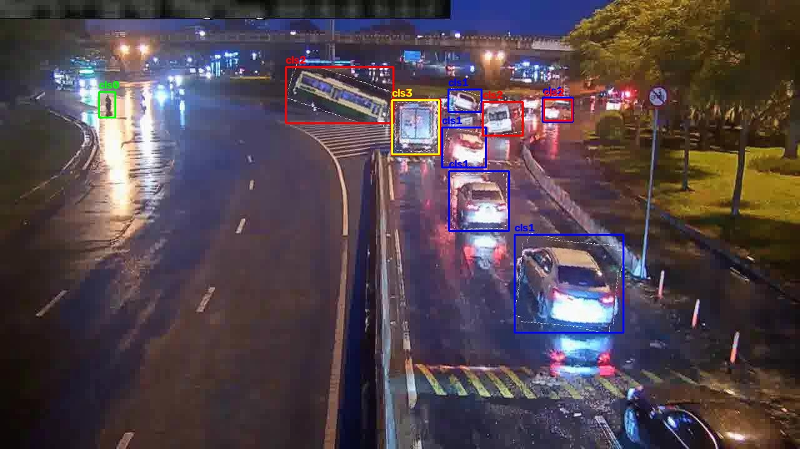

### 2.4 Phân phối class — V1 vs V3

So sánh dramatic giữa baseline cũ (DETRAC-heavy) và V3 (VN-only):

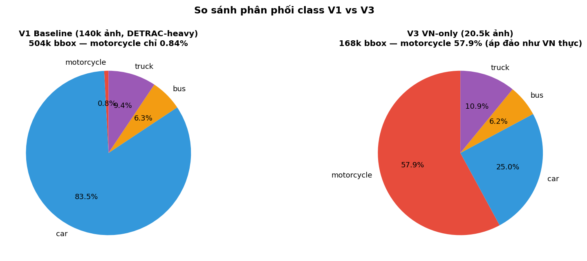

**Key insight**: V1 có motorcycle **0.84%** bbox (vì DETRAC là camera highway TQ, không có xe máy). V3 có motorcycle **57.9%** bbox — đúng pattern VN thực tế.

### 2.5 Composition cuối cùng — merged_v3

| Split | Ảnh | Nguồn |
|---|---:|---|
| **train** | **20,551** | SOICT-night 13.8k + SOICT24 4.8k + VNv3 1.2k + Cantho 0.7k |
| val | 1,779 | SOICT24-valid 1.4k + VNv3-valid 156 + Cantho-valid 216 |
| test | 1,053 | SOICT24-test 681 + VNv3-test 156 + Cantho-test 216 |

**Config file**: [data/data_v3.yaml](../../data/data_v3.yaml) — ultralytics đọc file này.

### 2.6 Visualize label distribution

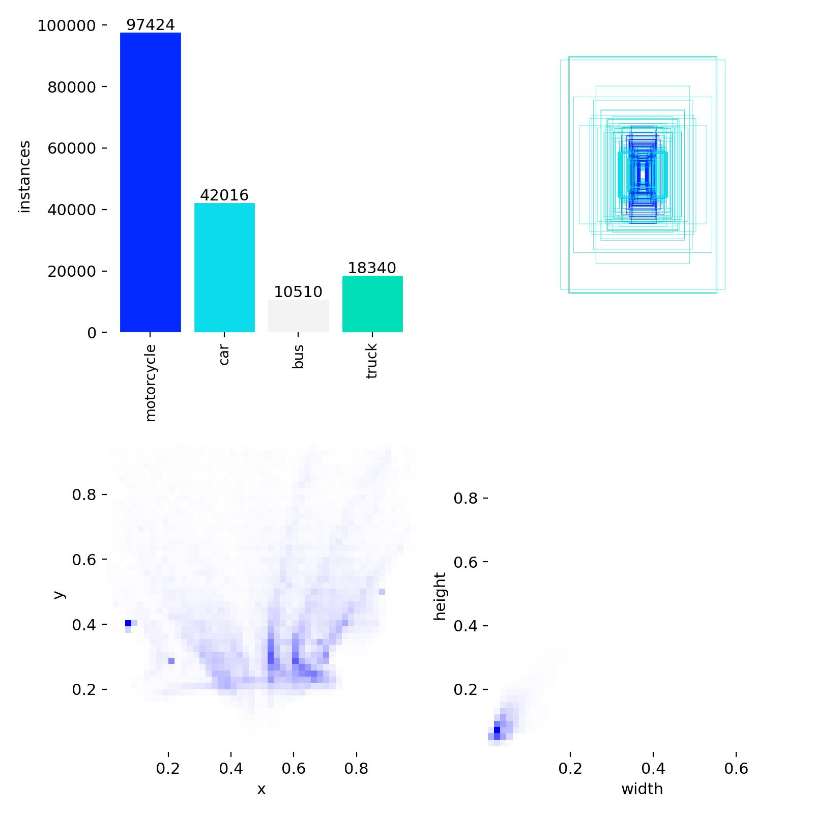

(Ultralytics tự sinh biểu đồ phân phối + bbox heatmap sau khi val set load.)

---

## 3. Mô hình YOLOv8s

### 3.1 Kiến trúc

YOLOv8s là single-stage object detector của Ultralytics, 3 phần:

```
Input (3, 640, 640)
    ↓
┌─────────────────────────────────────────┐
│  BACKBONE — CSPDarknet                  │   Trích xuất feature đa scale
│  5 stage downsample (P1→P5)             │
│  → feature maps 80×80, 40×40, 20×20     │
└─────────────────────────────────────────┘
    ↓
┌─────────────────────────────────────────┐
│  NECK — PAN-FPN (Path Aggregation)      │   Fuse feature nhiều scale
│  Top-down + Bottom-up path              │
│  → 3 feature maps mỗi scale             │
└─────────────────────────────────────────┘
    ↓
┌─────────────────────────────────────────┐
│  HEAD — Decoupled, anchor-free          │   Dự đoán bbox + class
│  3 head cho 3 scale (nhỏ/vừa/to)        │
│  Mỗi head: box reg (DFL) + cls          │
└─────────────────────────────────────────┘
    ↓
Output: N × (4 bbox + nc class scores)
```

**V8s params**: 11,127,132 (~11.1M) · GFLOPs: 28.4 · Model size: 22MB.

**Khác YOLOv8n** (nhỏ hơn 3.4×): backbone có width_multiple=0.5 thay vì 0.25.
**Khác YOLOv8m** (lớn hơn 2.3×): backbone width_multiple=0.75 + depth_multiple=0.67.

### 3.2 Vì sao chọn YOLOv8s?

- Sweet spot: mAP đủ cao (~0.95 trên VN) + FPS realtime (72 FPS trên RTX 3500 Ada)
- Size nhỏ (22MB) → dễ dockerize, deploy
- Anchor-free → dễ fine-tune cho dataset mới (không cần tính lại anchor)
- Decoupled head → predict class + box riêng, hội tụ nhanh hơn

### 3.3 Pretrained COCO

File `yolov8s.pt` (ở root) là trọng số pretrained COCO 80 class. Khi fine-tune:
- Giữ nguyên **backbone + neck** (feature extractor đã học edges, textures từ 100k ảnh COCO)
- **Head** được re-initialize cho 4 class VN (motorcycle, car, bus, truck)
- Learn-rate thấp hơn so với train from scratch (0.01 default → cosine decay)

---

## 4. Training pipeline

### 4.1 Workflow bên trong 1 epoch

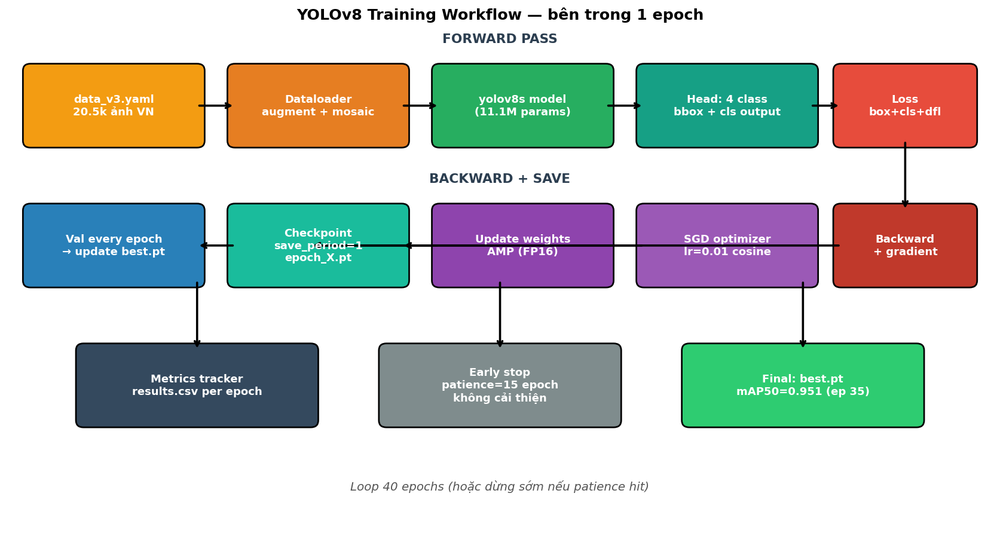

**Mỗi epoch**:
1. **Dataloader** chuẩn bị batch (augment + mosaic + letterbox)
2. **Forward pass**: input → backbone → neck → head → bbox + cls prediction
3. **Compute loss**: box + cls + dfl (xem [§5](#5-optimizer--loss-function))
4. **Backward**: autograd tính gradient
5. **Optimizer step**: SGD update weights (với momentum)
6. **AMP (FP16)** để tăng tốc 1.3-1.5× không mất accuracy
7. **Validation** sau mỗi epoch → tính mAP → cập nhật `best.pt` nếu cải thiện
8. **Save checkpoint** `last.pt` + `epoch_X.pt` (dùng `save_period=1` để resume được)

**Code chính**: [scripts/training/v3_vn_only.py](../../scripts/training/v3_vn_only.py) — đơn giản gọi `model.train(**CFG)`. Logic bên trong là `ultralytics.engine.trainer.BaseTrainer`.

### 4.2 Config V3 (chuẩn)

```python
CFG = dict(
    data        = "data/data_v3.yaml",   # dataset config
    epochs      = 40,
    batch       = 16,                     # fit 12GB VRAM @ imgsz=640
    imgsz       = 640,                    # input resolution
    lr0         = 0.01,                   # initial learning rate
    lrf         = 0.01,                   # final LR = lr0 * lrf
    patience    = 15,                     # early stop nếu không cải thiện
    optimizer   = "SGD",                  # momentum 0.937 default
    seed        = 42,
    workers     = 8,                      # dataloader threads
    cache       = "disk",                 # cache ảnh ra .npy — tăng tốc load
    amp         = True,                   # FP16 mixed-precision
    save_period = 1,                      # save every epoch
)
```

### 4.3 Smart start pattern

Mọi script training có 3 state:

```python
if done_epochs >= target and best_pt.exists():
    [SKIP]      # Đã train xong
elif last_pt.exists() and done_epochs > 0:
    [RESUME]    # Train tiếp từ last.pt (sau crash)
else:
    [FRESH]     # Bắt đầu từ pretrained
```

**Code**: [scripts/training/v3_vn_only.py:52-78](../../scripts/training/v3_vn_only.py#L52).

Lý do: laptop user từng sập nguồn do thermal → có `save_period=1` + smart start thì resume được không mất progress.

### 4.4 Training curves V3

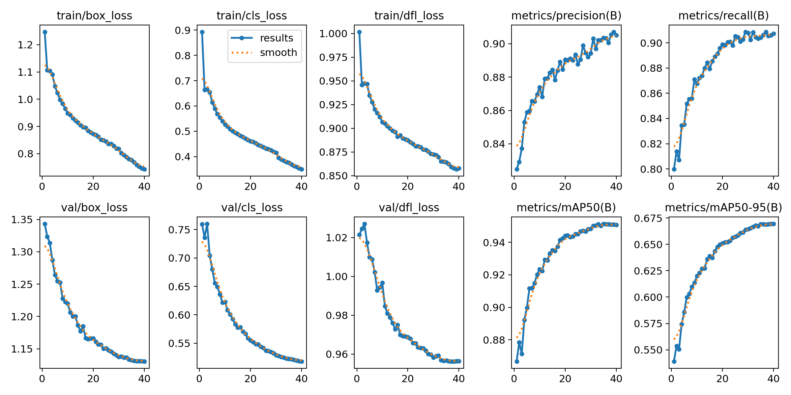

Quan sát:
- **Train loss** (box + cls + dfl) giảm đều qua 40 epoch
- **Val loss** cũng giảm, không bật lên → không overfit
- **mAP50** climb từ 0.87 → 0.95 trong 10 epoch đầu, plateau quanh 0.95 sau epoch 20
- **mAP50-95** climb chậm hơn (0.54 → 0.67) — bbox localization chính xác hóa dần
- **Best epoch 35**: mAP50=0.9514, mAP50-95=0.6692

### 4.5 Sample batch khi training

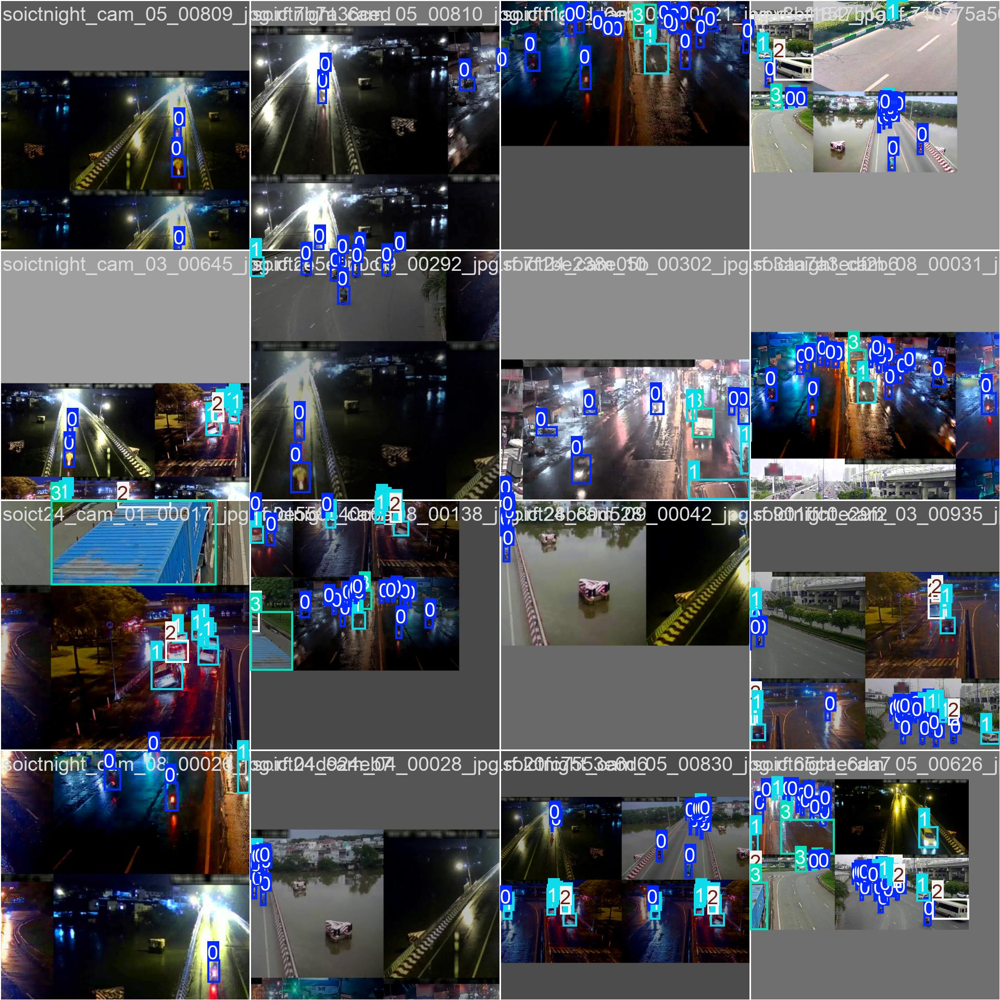

Ảnh 1 batch sau khi apply augmentation (mosaic 4 ảnh ghép, random flip, color jitter). Model nhìn batch này + ground truth bbox.

---

## 5. Optimizer + Loss function

### 5.1 Optimizer: SGD với Nesterov momentum

```
w_{t+1} = w_t - lr * (momentum * v_t + grad)
```

- `lr0 = 0.01` → cosine decay xuống `lr0 * lrf = 0.0001` ở epoch cuối
- `momentum = 0.937` (ultralytics default)
- `weight_decay = 0.0005` (L2 regularization chống overfitting)

**Cosine schedule** (tránh LR constant → dễ oscillation ở cuối):

```
lr(t) = lrf + (lr0 - lrf) * 0.5 * (1 + cos(π * t / T))
```

Vì sao SGD thay vì Adam?
- SGD generalize tốt hơn trên object detection (nhiều paper confirm)
- Adam hội tụ nhanh hơn ở epoch đầu nhưng final mAP thấp hơn ~1-2%

### 5.2 Loss function (3 thành phần)

YOLOv8 dùng **composite loss**:

```
L_total = λ_box * L_box + λ_cls * L_cls + λ_dfl * L_dfl
```

#### a) Box loss — CIoU (Complete IoU)

```
L_box = 1 - CIoU(pred_box, gt_box)
```

CIoU penalize đồng thời:
- Overlap area (như IoU gốc)
- Distance giữa 2 center
- Aspect ratio mismatch

Tốt hơn L1/L2 loss truyền thống (không cân nhắc shape).

#### b) Classification loss — BCE (Binary Cross-Entropy)

```
L_cls = -Σ [y * log(sigmoid(pred)) + (1-y) * log(1 - sigmoid(pred))]
```

Mỗi class 1 output score độc lập (không softmax). Hỗ trợ multi-label (1 bbox có thể thuộc nhiều class — không áp dụng cho project này nhưng flexible).

#### c) DFL loss — Distribution Focal Loss

YOLOv8 predict bbox dưới dạng **distribution** chứ không phải 4 scalar (x,y,w,h). Mỗi coordinate = 1 phân phối rời rạc trên 16 bins → DFL loss cross-entropy trên distribution → mượt hơn, bbox regression chính xác hơn.

### 5.3 Weights trong composite loss

Default ultralytics (có thể override):
- `λ_box = 7.5`
- `λ_cls = 0.5`
- `λ_dfl = 1.5`

Box loss weight cao nhất vì localization khó học hơn classification.

### 5.4 Data augmentation V3

| Augmentation | Giá trị | Mục đích |
|---|---|---|
| `mosaic = 1.0` | 100% | Ghép 4 ảnh → thấy nhiều scale + context |
| `close_mosaic = 10` | tắt 10 epoch cuối | Tránh distribution shift ở end training |
| `scale = 0.5` | random scale ±50% | Robust với bbox nhiều size |
| `translate = 0.1` | shift ±10% | Robust với vị trí |
| `fliplr = 0.5` | 50% horizontal flip | Robust left/right |
| `hsv_h/s/v = 0.015/0.7/0.4` | color jitter | Robust lighting (quan trọng cho SOICT-night) |

V3 **không** dùng `multi_scale`, `mixup`, aggressive `scale=0.9` như V2 fix — vì V2 chứng minh augmentation mạnh không giúp nhiều (chỉ +0.019 mAP so với V1).

---

## 6. Fine-tune evolution

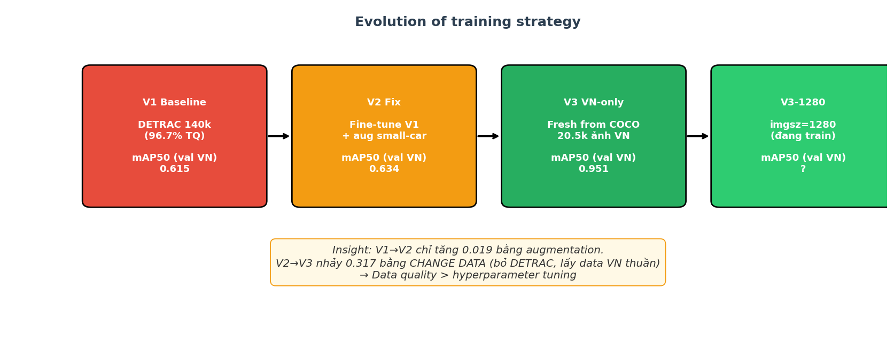

### 6.1 V1 Baseline (DETRAC-heavy)

- **Code**: [scripts/training/experiments/](../../scripts/training/experiments/) (reference only, không chạy lại)
- **Data**: 140k ảnh — DETRAC 96.7% + VN 3.3%
- **Config**: yolov8s + warm từ COCO + 18 epoch
- **Best**: epoch 8, mAP50 (val DETRAC-heavy) = 0.860
- **Fair re-eval trên val VN**: mAP50 = **0.615** (bị TQ-bias)

### 6.2 V2 Fix (small-car targeted)

- **Code**: [scripts/training/v2_fix_small_car.py](../../scripts/training/v2_fix_small_car.py)
- **Hypothesis**: V1 miss car nhỏ (xa camera) → aug mạnh scale/mixup giúp bắt
- **Config**: fine-tune V1 best.pt, `imgsz=512`, `scale=0.9`, `multi_scale=True`, `mixup=0.15`, `lr=0.003`
- **Best**: epoch 5, mAP50 (val VN) = **0.634** — chỉ +0.019 so V1
- **Bài học**: augmentation mạnh chỉ cải thiện marginal, không fix được root cause

### 6.3 V3 VN-only (data-centric revolution)

- **Code**: [scripts/training/v3_vn_only.py](../../scripts/training/v3_vn_only.py)
- **Hypothesis**: DETRAC-TQ domain phá VN. Bỏ hẳn + bổ sung 20k ảnh VN mới (SOICT)
- **Config**: FRESH từ COCO, `imgsz=640`, `batch=16`, 40 epoch, config conservative (no aggressive aug)
- **Dataset**: 20.5k ảnh VN thuần (xem [§2.5](#25-composition-cuối-cùng--merged_v3))
- **Best**: epoch 35, mAP50 (val VN) = **0.951** — **+0.317** so V2
- **Bài học**: Data quality > hyperparameter tuning. Đổi distribution = step-change, tuning = incremental.

### 6.4 V3-1280 (ongoing)

- **Code**: [scripts/week2/07_train_v3_1280.py](../../scripts/week2/07_train_v3_1280.py)
- **Hypothesis**: motorcycle nhỏ → `imgsz=1280` giữ nhiều pixel → bbox nhỏ localize chuẩn hơn
- **Config**: FRESH từ COCO, `imgsz=1280`, `batch=8` (giảm vì VRAM), 40 epoch
- **Trade-off**: ~8h train vs 3h (V3 640). Expected: motorcycle mAP50-95 tăng từ 0.585 → ~0.65

---

## 7. Evaluation methodology

### 7.1 Metrics chính

| Metric | Ý nghĩa |
|---|---|
| **Precision** | TP / (TP + FP) — bắt gì ra là đúng tỉ lệ bao nhiêu |
| **Recall** | TP / (TP + FN) — bắt được bao nhiêu % object thực sự |
| **mAP@0.5** | Average Precision ở IoU=0.5 (lỏng, metric chuẩn) |
| **mAP@0.5:0.95** | Trung bình mAP tại 10 IoU threshold [0.5, 0.55, ..., 0.95] (strict) |

**IoU (Intersection over Union)**: diện tích overlap chia diện tích tổng — đo "khớp" bbox pred vs gt.

### 7.2 Fair comparison

**Vấn đề**: V1 công bố mAP50=0.858 nhưng **trên val DETRAC-heavy**. Model V1 quen domain đó → inflated.

**Fix**: Eval **cùng 1 val VN-only** (1,779 ảnh) cho mọi model:
- V1, V2, V3 → mAP có nghĩa so sánh được
- yolov8s COCO vanilla cũng eval (map COCO class 2/3/5/7 → canonical) để biết baseline tự nhiên

**Code**: [scripts/evaluation/eval_coco_vs_v3.py](../../scripts/evaluation/eval_coco_vs_v3.py).

### 7.3 Kết quả fair comparison

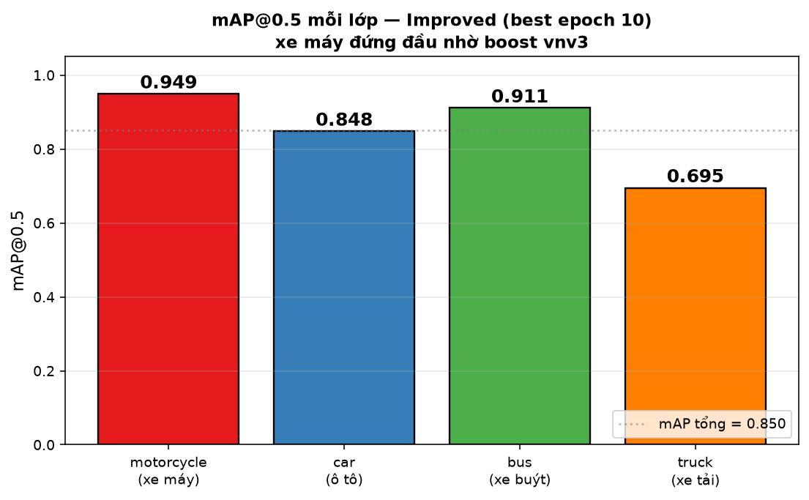

| Model | mAP50 | mAP50-95 | motorcycle | bus |
|---|---:|---:|---:|---:|
| yolov8s COCO vanilla | 0.439 | 0.245 | 0.051 | 0.260 |
| V1 baseline | 0.615 | 0.321 | 0.636 | 0.435 |
| V2 fix | 0.634 | 0.346 | 0.693 | 0.435 |
| **V3 VN-only** | **0.951** | **0.670** | **0.955** | **0.951** |

Highlights:
- V3 vượt COCO vanilla **2.1×** ở mAP50
- Motorcycle: COCO chỉ 0.051 → V3 0.955 (**19×**) vì COCO không có xe máy VN (xe tay ga, honda wave)
- Bus: COCO 0.260 → V3 0.951 (3.7×) vì bus COCO khác bus VN

### 7.4 PR curve (Precision-Recall)

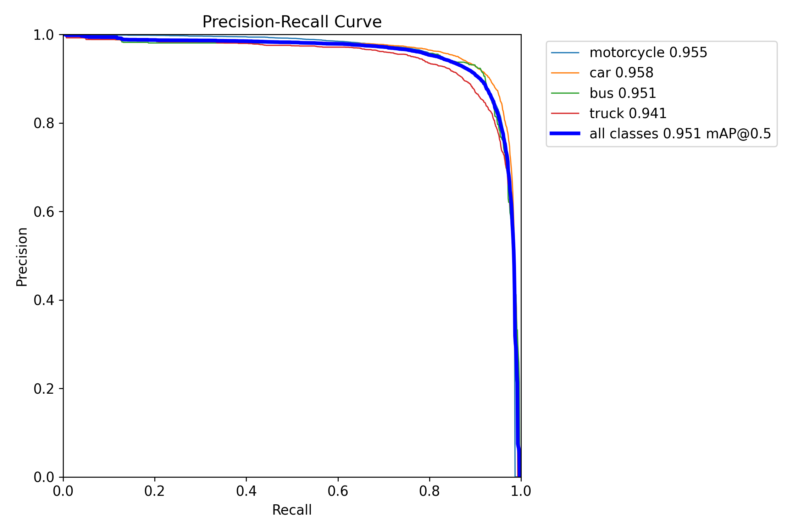

Mọi class đều có curve nằm cao (AP ≥ 0.94). Khác với V1/V2 có bus curve collapse về 0.4.

### 7.5 F1-score curve

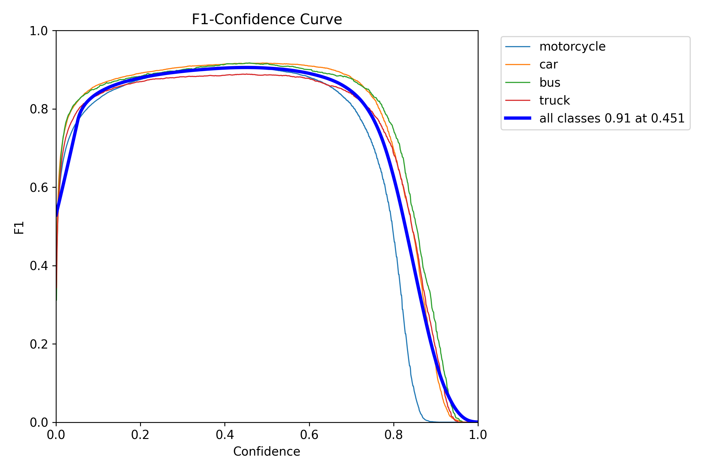

F1 = 2PR/(P+R). Peak F1 quanh confidence threshold ~0.3-0.4 → nên dùng `conf=0.25-0.3` khi inference.

### 7.6 Confusion matrix


- Diagonal cao (0.90+ mọi class) → model phân biệt 4 class tốt
- Nhầm chính: motorcycle ↔ background (motorcycle nhỏ, dễ bị miss hoặc false alarm)
- Không có nhầm cross-class → không có class ambiguity

### 7.7 Predictions vs Ground truth (val sample)

**Prediction V3**:

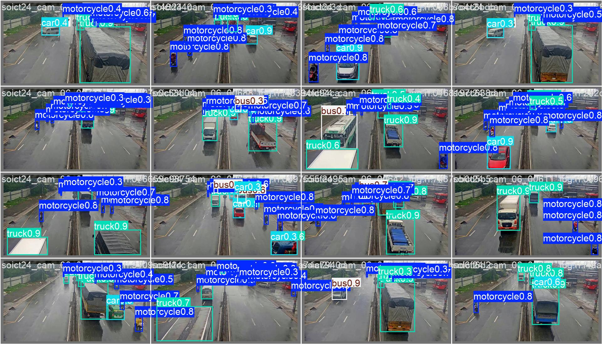

**Ground truth**:

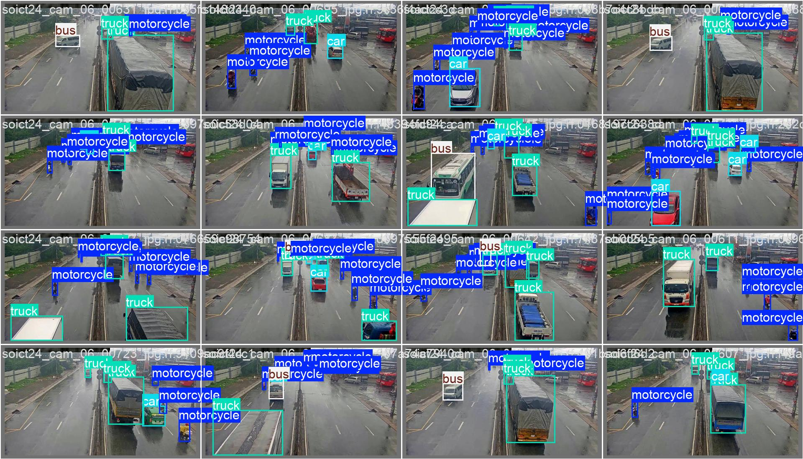

So sánh 2 ảnh thấy V3 bắt gần hết object kể cả xe máy nhỏ ở xa.

---

## 8. Runtime pipeline (inference)

Khi deploy model, pipeline chạy mỗi frame:

```
Frame (BGR, from cv2) → YOLO.track() → bbox + class + tracking_id
                                            ↓
                                   Counter.update(prev_center, curr_center, lines)
                                            ↓
                                   events list + draw_overlay()
                                            ↓
                                   cv2.VideoWriter + CSV log
```

**Entry point**: [src/pipeline/run.py:73 `run_pipeline()`](../../src/pipeline/run.py#L73).

### 8.1 Model.track()

Khác với `model.predict()`, `track()` dùng **tracker** để persist tracking ID qua các frame.

**Code**: [src/tracking/track.py:9](../../src/tracking/track.py#L9).

```python
model = YOLO("weights/v3_vn_best.pt")
model.track(
    source=video_path,
    tracker="bytetrack.yaml",  # hoặc "botsort.yaml"
    conf=0.25, iou=0.5, imgsz=640,
    persist=True,   # keep tracking state across calls
    stream=True,    # yield mỗi frame thay vì load hết vào RAM
)
```

Mỗi `result` yield ra có `result.boxes.id` chứa tracking ID (số nguyên).

### 8.2 Confidence + IoU threshold

- **conf (confidence)**: ngưỡng để model "accept" prediction. Default 0.25. Thấp hơn = bắt nhiều hơn (recall tăng, precision giảm).
- **iou (IoU threshold for NMS)**: khi 2 bbox dự đoán overlap > 0.5, giữ bbox có conf cao hơn (non-maximum suppression).

---

## 9. Tracking — ByteTrack

### 9.1 Vấn đề cần tracker

Model detect độc lập mỗi frame → không biết "object #3 ở frame t là cùng object với #5 ở frame t+1". Tracker gán **tracking_id** nhất quán.

### 9.2 Thuật toán ByteTrack

Nguyên lý: không bỏ box low-confidence (như SORT), mà "giải cứu" chúng bằng cách match với track đang có.

Mỗi frame:
1. **Detect** → chia box thành 2 nhóm:
   - High-conf (conf ≥ 0.6)
   - Low-conf (0.1 ≤ conf < 0.6)
2. **Match high-conf** với existing tracks bằng Hungarian algorithm (IoU cost)
3. **Match leftover tracks** (chưa match ở step 2) với **low-conf** boxes
4. Tracks không match: giảm `active_frames`, nếu > buffer → delete
5. High-conf boxes không match: tạo track mới

Vì sao hiệu quả: xe máy VN đi nhanh, bị motion blur → conf giảm tạm thời. ByteTrack giữ track thay vì mất ID.

**Config**: file `bytetrack.yaml` của ultralytics (xem bên trong env):
```yaml
tracker_type: bytetrack
track_high_thresh: 0.5
track_low_thresh: 0.1
new_track_thresh: 0.6
track_buffer: 30  # giữ track 30 frame trước khi delete
match_thresh: 0.8
```

**Alternative**: BoT-SORT có thêm camera motion compensation + appearance feature. Nhưng chậm hơn và project chưa cần.

---

## 10. Counting — line crossing math

### 10.1 Nguyên lý

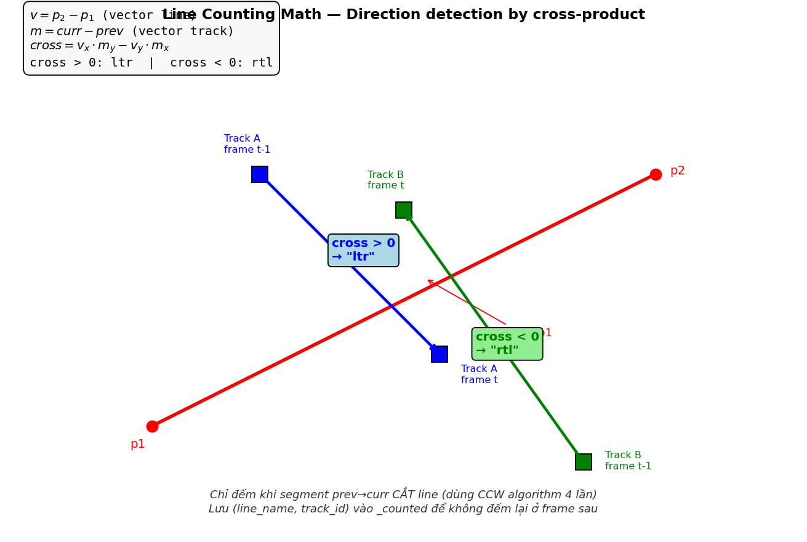

**Mỗi track** có 1 center bbox. Lưu center của frame trước (`prev`) và frame hiện tại (`curr`).

Nếu **segment prev→curr CẮT counting line** → đếm 1 lần. Lưu `(line_name, track_id)` vào set `_counted` để không đếm lại.

### 10.2 Segment intersection (CCW algorithm)

Dùng tính chất **counter-clockwise (CCW)** của 3 điểm:

```python
def ccw(p, q, r):
    return (r[1]-p[1])*(q[0]-p[0]) > (q[1]-p[1])*(r[0]-p[0])

# Segment a1-a2 cắt b1-b2 khi:
# - a1 & a2 nằm 2 bên của đường thẳng chứa b1-b2
# - b1 & b2 nằm 2 bên của đường thẳng chứa a1-a2
def segments_cross(a1, a2, b1, b2):
    return (ccw(a1, b1, b2) != ccw(a2, b1, b2)
            and ccw(a1, a2, b1) != ccw(a1, a2, b2))
```

**Code**: [src/tracking/counter.py:38-43](../../src/tracking/counter.py#L38).

### 10.3 Direction (ltr vs rtl)

Dùng **cross-product** của 2 vector:
- `v = p2 - p1` (vector counting line)
- `m = curr - prev` (vector track movement)

```python
cross = v.x * m.y - v.y * m.x
# cross > 0 → "ltr" (left-to-right theo chiều v)
# cross < 0 → "rtl" (right-to-left)
```

**Code**: [src/tracking/counter.py:46-53](../../src/tracking/counter.py#L46).

### 10.4 Chống đếm trùng

```python
key = (line.name, track_id)
if key in self._counted:
    continue  # đã đếm, skip
# ... (compute cross, direction)
self._counted.add(key)
```

Giúp: xe quay đầu đi qua line nhiều lần cũng chỉ đếm 1 lần cho mỗi (line, track_id).

### 10.5 Config lines

File [configs/counting_zones.json](../../configs/counting_zones.json):

```json
{
  "demo_traffic": {
    "video_resolution": [1764, 948],
    "lines": [
      {
        "name": "middle_horizontal",
        "points": [[100, 474], [1664, 474]],
        "count_direction": "both"
      }
    ]
  }
}
```

**Load trong code**: [src/tracking/counter.py:27 `load_lines()`](../../src/tracking/counter.py#L27).

### 10.6 Output events

Mỗi lần đếm 1 object qua line → 1 event:

```json
{
  "frame": 142,
  "time_sec": 5.68,
  "line": "middle_horizontal",
  "direction": "ltr",
  "track_id": 7,
  "class_name": "motorcycle"
}
```

Export CSV ở [src/pipeline/run.py:141](../../src/pipeline/run.py#L141).

---

## 11. Streamlit UI

**File**: [ui/streamlit_app.py](../../ui/streamlit_app.py) (769 dòng).

### 11.1 Features

- Upload video (mp4/avi/mov)
- Chọn model weights từ `weights/`
- Chọn pipeline: Baseline (file GV) vs Improved (nhóm)
- Chọn tracker: ByteTrack vs BoT-SORT
- Config conf, IoU, imgsz, FP16
- Draw counting line interactively
- Mode "⚖ So sánh 2 pipeline side-by-side"
- Tab stats: tổng số đếm theo class + direction
- Tab eval: so với GT thủ công

### 11.2 Chạy

```bash
cd /home/xuand/vn_traffic_ai
streamlit run ui/streamlit_app.py
# Mở http://localhost:8501
```

### 11.3 Screenshot (từ demo trước)

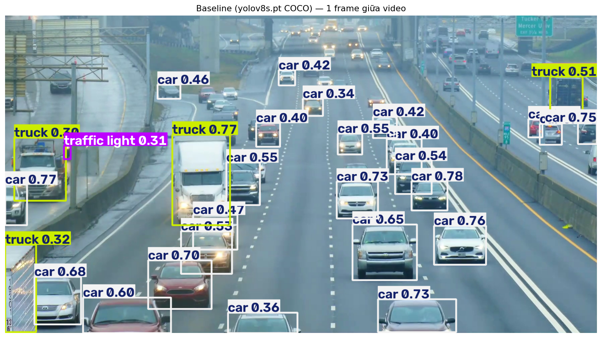

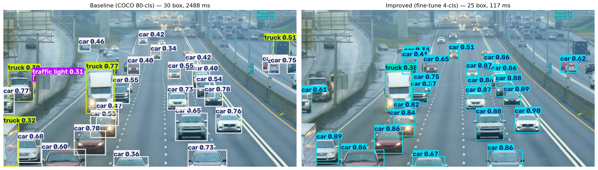

---

## 12. Code map

Dành cho khi bạn muốn hiểu 1 feature cụ thể — mở file này đọc trước.

### 12.1 Data preparation

| File | Vai trò |
|---|---|
| [scripts/data_prep/import_soict.py](../../scripts/data_prep/import_soict.py) | Giải nén 2 bộ SOICT, remap class, prefix tên |
| [scripts/data_prep/import_vnv3.py](../../scripts/data_prep/import_vnv3.py) | Import VNv3 (Roboflow) + merge |
| [scripts/data_prep/import_cantho_vn.py](../../scripts/data_prep/import_cantho_vn.py) | Import Cantho VN + remap class |
| [scripts/data_prep/import_ua_detrac.py](../../scripts/data_prep/import_ua_detrac.py) | Import UA-DETRAC TQ (deprecated V3) |
| [scripts/data_prep/merge_v3.py](../../scripts/data_prep/merge_v3.py) | Build `data/merged_v3/` từ raw sources (VN-only) |

### 12.2 Training

| File | Vai trò |
|---|---|
| [scripts/training/v3_vn_only.py](../../scripts/training/v3_vn_only.py) | Train V3 (chủ đạo, mAP50=0.951) |
| [scripts/training/v2_fix_small_car.py](../../scripts/training/v2_fix_small_car.py) | Train V2 fix (fine-tune V1 + aug) |
| [scripts/week2/07_train_v3_1280.py](../../scripts/week2/07_train_v3_1280.py) | Train V3 imgsz=1280 (optional, đang chạy) |
| [scripts/training/experiments/v2_freeze10.py](../../scripts/training/experiments/v2_freeze10.py) | Ablation: freeze backbone |
| [scripts/training/experiments/v2_class_weights.py](../../scripts/training/experiments/v2_class_weights.py) | Ablation: boost cls loss |
| [scripts/training/experiments/v2_yolov8m.py](../../scripts/training/experiments/v2_yolov8m.py) | Ablation: YOLOv8m scaling |

### 12.3 Evaluation

| File | Vai trò |
|---|---|
| [scripts/evaluation/eval_coco_vs_v3.py](../../scripts/evaluation/eval_coco_vs_v3.py) | Fair eval V1/V2/V3 vs COCO trên cùng val VN |
| [scripts/evaluation/eval_all_models.py](../../scripts/evaluation/eval_all_models.py) | 6-way comparison + chart |
| [scripts/evaluation/eval_counting.py](../../scripts/evaluation/eval_counting.py) | Counting accuracy baseline vs improved |
| [scripts/evaluation/eval_tracking_proxy.py](../../scripts/evaluation/eval_tracking_proxy.py) | Tracking quality proxy metrics |
| [scripts/evaluation/bench_new_video.py](../../scripts/evaluation/bench_new_video.py) | FPS benchmark + visual compare |

### 12.4 Core library (`src/`)

| File | Vai trò |
|---|---|
| [src/detection/train.py](../../src/detection/train.py) | Generic train wrapper (gọi ultralytics) |
| [src/detection/infer.py](../../src/detection/infer.py) | Generic infer wrapper |
| [src/detection/evaluate.py](../../src/detection/evaluate.py) | Val wrapper |
| [src/tracking/track.py](../../src/tracking/track.py) | ByteTrack/BoT-SORT wrapper |
| [src/tracking/counter.py](../../src/tracking/counter.py) | Line counter + direction + anti-duplicate |
| [src/pipeline/run.py](../../src/pipeline/run.py) | End-to-end pipeline (CLI + import function) |
| [src/evaluation/eval_full.py](../../src/evaluation/eval_full.py) | 2-tầng eval (mAP + counting) |
| [src/evaluation/metrics.py](../../src/evaluation/metrics.py) | Counting accuracy metrics |
| [src/evaluation/compare.py](../../src/evaluation/compare.py) | Side-by-side comparison |
| [src/stats/aggregator.py](../../src/stats/aggregator.py) | Thống kê theo time bucket |
| [src/stats/visualize.py](../../src/stats/visualize.py) | Charts matplotlib |

### 12.5 UI + reports

| File | Vai trò |
|---|---|
| [ui/streamlit_app.py](../../ui/streamlit_app.py) | Streamlit full UI |
| [baseline/10_traffic_counting.py](../../baseline/10_traffic_counting.py) | File giáo viên gốc (reference) |
| [docs/v3_report/v3_vn_only_report.md](../v3_report/v3_vn_only_report.md) | Báo cáo V3 chi tiết |
| [docs/comparison_report/comparison_report.md](../comparison_report/comparison_report.md) | Báo cáo so sánh baseline vs improved |

### 12.6 Config

| File | Vai trò |
|---|---|
| [configs/class_mapping.json](../../configs/class_mapping.json) | Mapping class 4 dataset → canonical |
| [configs/counting_zones.json](../../configs/counting_zones.json) | Define counting lines per video |
| [data/data_v3.yaml](../../data/data_v3.yaml) | YOLO dataset config cho V3 |
| [data/data.yaml](../../data/data.yaml) | YOLO dataset config cho V1 (DETRAC-heavy) |
| [data/data_vn_only.yaml](../../data/data_vn_only.yaml) | Config vn_only cho eval domain-specific |

---

## 13. Phụ lục: Khái niệm cốt lõi

### 13.1 Object detection vs classification

- **Classification**: ảnh → 1 label ("đây là motorcycle")
- **Detection**: ảnh → N bbox + label mỗi bbox ("có 3 motorcycle ở vị trí A, B, C")

Detection khó hơn vì phải vừa phân loại vừa localize.

### 13.2 Anchor-based vs Anchor-free

- **Anchor-based** (YOLOv4, v5): sinh K anchor box với scale/ratio định trước → predict offset so với anchor
- **Anchor-free** (YOLOv8, FCOS): predict trực tiếp bbox từ feature map, không cần anchor định trước

YOLOv8 anchor-free → đơn giản hơn, dễ fine-tune cho dataset mới (không cần recompute anchor).

### 13.3 IoU, mAP

**IoU**:
```
IoU = Area(pred ∩ gt) / Area(pred ∪ gt)
```
0.5 là threshold "khớp" tiêu chuẩn.

**AP (Average Precision)** cho 1 class ở 1 IoU threshold:
1. Sắp xếp predictions theo confidence giảm dần
2. Mỗi prediction: TP nếu match 1 gt với IoU ≥ threshold, FP nếu không
3. Tính precision & recall qua từng ngưỡng cutoff
4. AP = area under PR curve

**mAP@0.5**: mean AP across all classes, với IoU threshold = 0.5.
**mAP@0.5:0.95**: trung bình mAP ở 10 threshold IoU từ 0.5 đến 0.95 bước 0.05 (strict).

### 13.4 Mosaic augmentation

Ghép 4 ảnh thành 1 ảnh lớn → model thấy 4 scenes × 4 scales trong 1 forward pass. Tăng diversity + hiệu quả training. YOLOv8 default dùng mosaic cho 90% epoch đầu, tắt 10 epoch cuối (`close_mosaic`) để model fine-tune trên ảnh "thật".

### 13.5 Mixed-precision training (AMP)

Chia weights:
- Dùng **FP32** cho master weights (lưu trữ chính xác)
- Compute forward + backward bằng **FP16** (nhanh gấp 2× trên GPU Ampere/Ada)
- Scale loss để tránh FP16 underflow

Kết quả: ~1.3-1.5× tăng tốc, không mất accuracy. Flag: `amp=True`.

### 13.6 Learning rate schedule

Tại sao LR phải decrease?
- Early: cần LR cao để escape local minima
- Late: cần LR thấp để fine-grained converge, không oscillate

**Cosine schedule** (ultralytics default): smooth decay, không có "jump" như step schedule.

### 13.7 Early stopping (patience)

Nếu `patience=15` → nếu 15 epoch liên tiếp không có cải thiện mAP → dừng. Giúp:
- Tiết kiệm compute
- Tránh overfit epoch cuối

V3 chạy đủ 40 epoch (không hit patience) vì vẫn improve.

### 13.8 Train/Val/Test split

- **Train**: model học, update weight
- **Val**: eval mỗi epoch, dùng để chọn best.pt + early stop
- **Test**: eval cuối cùng, model CHƯA bao giờ thấy → đánh giá generalization thật

Project V3:
- Train 20,551 (SOICT24-train + SOICT-night + VNv3-train + Cantho-train)
- Val 1,779 (SOICT24-valid + VNv3-valid + Cantho-valid)
- Test 1,053 (SOICT24-test + VNv3-test + Cantho-test)

---

## Kết luận

Project này **data-centric**: V1→V2 chỉ tăng 0.019 bằng augmentation tuning, V2→V3 nhảy 0.317 bằng CHANGE data (bỏ DETRAC + bổ sung SOICT VN). **Bài học lớn nhất**: trước khi tune hyperparam, hỏi xem data distribution có khớp target domain không.

Về code: `src/` là core library (import được), `scripts/` là CLI workflows, `ui/streamlit_app.py` là demo. 3 tầng tách biệt → mỗi tầng edit được độc lập.

Về CV pipeline: Detect (YOLOv8s) → Track (ByteTrack) → Count (segment-cross) → Export (CSV + MP4). Mỗi step 1 module riêng, dễ swap component (ví dụ đổi tracker ByteTrack ↔ BoT-SORT).

---

**File gốc**: `docs/handbook/vn_traffic_ai_handbook.md`
**File docx**: `docs/handbook/vn_traffic_ai_handbook.docx` (nếu đã convert)
