# Báo cáo phân tích dự án
## Phát hiện phương tiện giao thông Việt Nam bằng YOLOv8 — từ data leakage đến model honest

**Tác giả:** xuanduc24905
**Ngày:** 2026-10-27
**Môn học:** Đồ án chuyên ngành (chủ đề 10 — đếm xe qua camera giao thông)

---

## Mục lục

1. [Giới thiệu dự án và bối cảnh](#chương-1--giới-thiệu-dự-án-và-bối-cảnh)
2. [Dataset — chúng ta có gì?](#chương-2--dataset--chúng-ta-có-gì)
3. [Triển khai: hiểu format YOLO và cấu trúc dataset](#chương-25--triển-khai-hiểu-format-yolo-và-cấu-trúc-dataset)
4. [Phát hiện vấn đề: con số đẹp bất thường](#chương-3--phát-hiện-vấn-đề-con-số-đẹp-bất-thường)
5. [Giải thích Data Leakage cho người không chuyên](#chương-4--giải-thích-data-leakage-cho-người-không-chuyên)
6. [Audit định lượng: đo chính xác mức độ leakage](#chương-5--audit-định-lượng-đo-chính-xác-mức-độ-leakage)
7. [Giải pháp: Rebuild dataset với Video-Aware Split](#chương-6--giải-pháp-rebuild-dataset-với-video-aware-split)
8. [Train model honest + validate kết quả thật](#chương-7--train-model-honest--validate-kết-quả-thật)
9. [Các thử nghiệm mở rộng: V5+, V6, V7](#chương-8--các-thử-nghiệm-mở-rộng-v5-v6-v7)
10. [Error analysis — model yếu ở đâu?](#chương-9--error-analysis--model-yếu-ở-đâu)
11. [Tổng kết, bài học và hướng đi tiếp theo](#chương-10--tổng-kết-bài-học-và-hướng-đi-tiếp-theo)

---

## Chương 1 — Giới thiệu dự án và bối cảnh

### Mục tiêu

Xây dựng mô hình **phát hiện và phân loại 4 loại phương tiện giao thông** (motorcycle / car / bus / truck) trên camera CCTV đường phố Việt Nam, dùng cho các ứng dụng:
- Đếm số lượng phương tiện qua camera (traffic counting)
- Thống kê mật độ giao thông real-time
- Hỗ trợ hệ thống đèn tín hiệu thích ứng

### Đặc thù bài toán giao thông Việt Nam

Giao thông VN có những đặc điểm **rất khác** so với các dataset quốc tế thông dụng (COCO, UA-DETRAC...):

| Đặc điểm | Giao thông VN | Dataset quốc tế |
|---|---|---|
| Tỉ lệ xe máy | **40-60% phương tiện** | ~2-5% (COCO) |
| Mật độ phương tiện | Rất dày (giờ cao điểm 30-50 xe/khung hình) | Trung bình 5-10 xe |
| Góc camera | Top-down từ trụ cao (CCTV) | Side-view (dashcam, highway cam) |
| Phân phối class | Mất cân bằng nghiêm trọng (motorcycle:bicycle = 40:1) | Cân bằng hơn |

→ **Mô hình pretrained COCO không đủ** — phải finetune với data VN.

### Workflow tổng quan

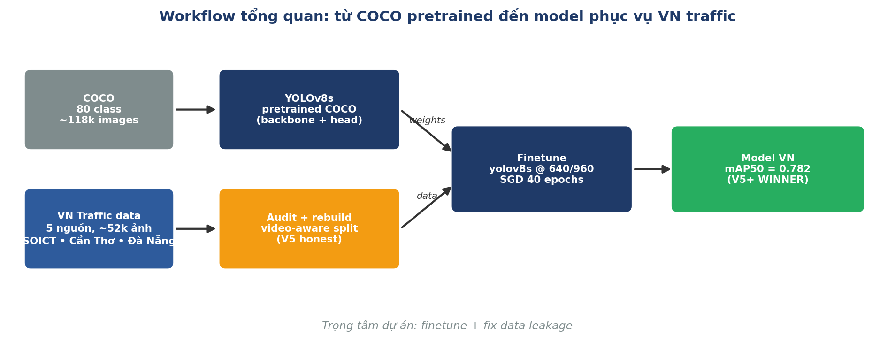

Trọng tâm dự án nằm ở **finetune + fix data leakage** — vòng bên dưới của diagram.

### Scope project

- 1 model workable + báo cáo đầy đủ
- Methodology research-honest (methodology đúng > số liệu cao)
- Chạy được pipeline end-to-end: data → train → eval → demo

---

## Chương 2 — Dataset: chúng ta có gì?

Dự án tổng hợp **5 nguồn dataset**, tổng cộng ~52,000 ảnh raw:

### 2.1 Danh sách nguồn

| Nguồn | Số frames | Loại | Mô tả |
|---|---|---|---|
| SOICT 2024 (ngày) | 6,892 | CCTV | 10 camera (`cam_01`-`cam_10`), giờ hành chính |
| SOICT Night | 13,834 | CCTV | 3 camera đêm (`cam_03`, `05`, `08`) |
| Cantho VN | 1,110 | CCTV | 4 video phố Cần Thơ |
| VNv3 | 1,547 | Mixed | 1 video liên tục |
| VN CCTV Đà Nẵng | 29,195 | CCTV | 1 video 29k frames liên tục |

### 2.2 Ảnh mẫu từng nguồn

**SOICT Night (camera đêm, Hà Nội):**
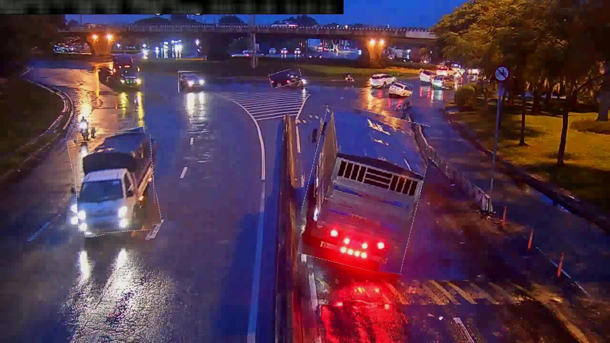

**SOICT 24 (camera ngày):**
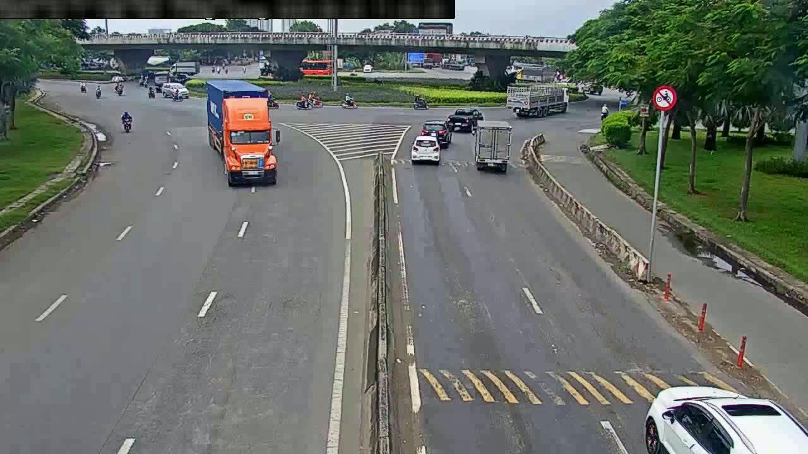

**Cantho (phố Cần Thơ):**
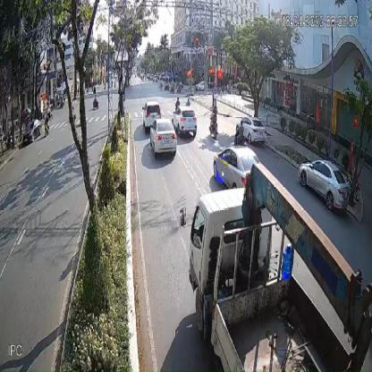

**VNv3:**
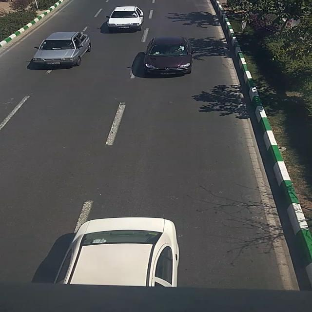

**VN CCTV Đà Nẵng:**
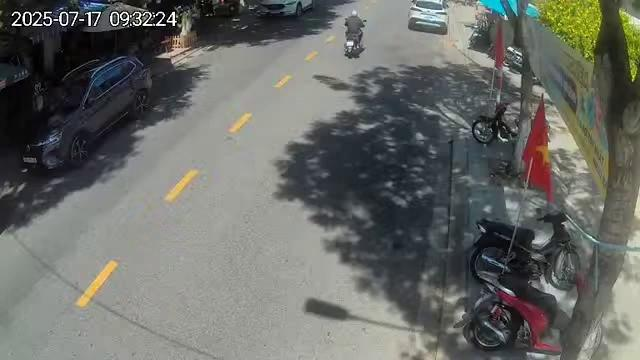

### 2.3 Phát hiện quan trọng về nguồn data

Khi phân tích kỹ, mỗi "dataset" thực ra là **vài video được tách thành nhiều frames liên tiếp**:

```
"52,578 ảnh" nghe nhiều?
→ Thực tế chỉ ~18 video source khác nhau
→ Mỗi video quay 30s-5 phút → 500-30,000 frames liên tiếp
```

**Hệ quả:** Nếu không cẩn thận về cách split train/val/test, sẽ gặp **data leakage** nghiêm trọng (xem Chương 3).

### 2.4 Schema class thống nhất

Dự án quy đổi mọi dataset về cùng 4 class:

```yaml
nc: 4
names:
  0: motorcycle   # xe máy, scooter
  1: car          # ô tô con, SUV
  2: bus          # xe buýt, coach
  3: truck        # xe tải, pickup
```

Các class khác (bicycle, auto-rickshaw, van, person...) được **drop** hoặc merge.

---

## Chương 2.5 — Triển khai: hiểu format YOLO và cấu trúc dataset

Trước khi vào các vấn đề data leakage, cần nắm rõ **data đang nằm ở đâu, trông như thế nào, model đọc được gì**. Phần này giải thích chi tiết với ví dụ thực tế lấy từ `data/merged_v5/` của dự án.

### 2.5.1 Ultralytics YOLOv8 cần gì ở input?

YOLOv8 (framework Ultralytics) nhận dataset qua **1 file YAML duy nhất** trỏ tới 3 folder ảnh (train/val/test). Mỗi ảnh phải đi kèm 1 file nhãn `.txt` cùng tên trong thư mục nhãn song song.

### 2.5.2 Cấu trúc thư mục dataset

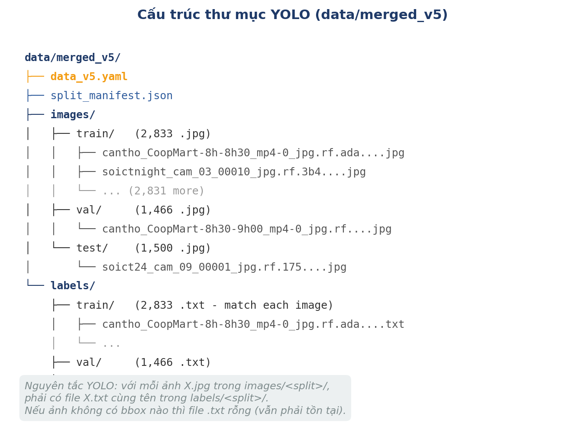

**Hai nguyên tắc bất di bất dịch:**

1. **Song song images/ ↔ labels/** — folder `images/<split>/` và `labels/<split>/` phải có số file bằng nhau, tên khớp 1-1 (chỉ khác đuôi `.jpg` ↔ `.txt`).
2. **File .txt rỗng cũng phải tồn tại** — nếu ảnh không chứa phương tiện nào, vẫn tạo file `.txt` rỗng để Ultralytics biết đây là **negative sample** (không bỏ qua).

### 2.5.3 File data_v5.yaml — config trỏ tới dataset

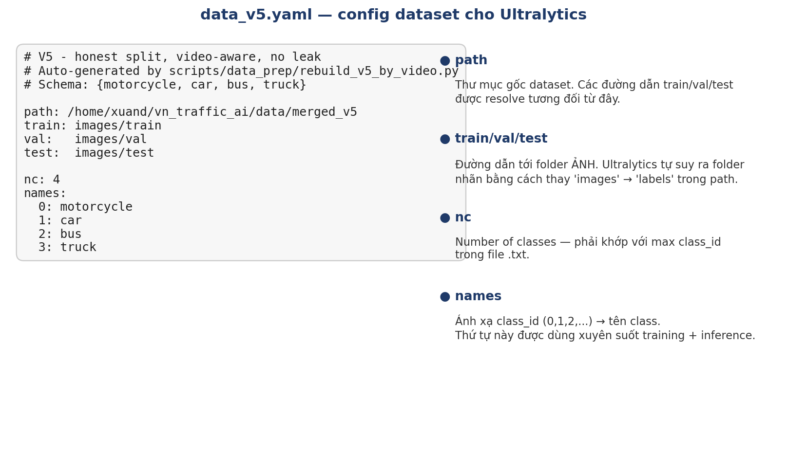

Khi gọi `yolo train data=data_v5.yaml ...`, Ultralytics:
1. Mở YAML, đọc `path` + `train/val/test`
2. Tự suy ra folder nhãn (`images/` → `labels/`)
3. Verify từng ảnh có file nhãn tương ứng
4. Cache ảnh ra file `.cache` (lần train sau nhanh hơn)

### 2.5.4 Format nhãn YOLO — 1 dòng = 1 bounding box

Mỗi file `.txt` có nhiều dòng, mỗi dòng 5 số cách nhau bằng khoảng trắng:

```
class  cx  cy  w  h
```

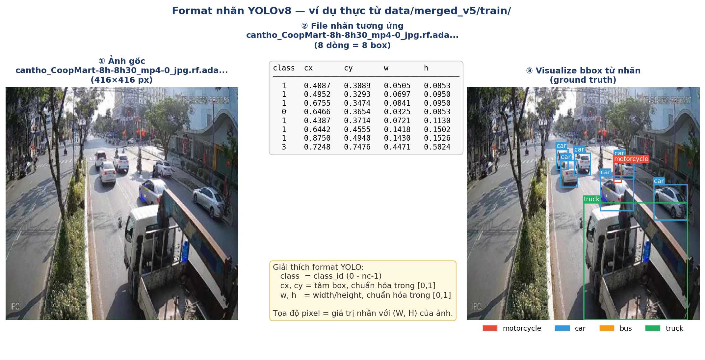

Panel ① là ảnh gốc, panel ② là file `.txt` thực của ảnh đó (lấy nguyên văn từ `data/merged_v5/labels/train/`), panel ③ là bbox được vẽ lại từ chính các số trong file `.txt`.

### 2.5.5 Hệ tọa độ chuẩn hóa [0, 1]

Tất cả tọa độ YOLO đều **chuẩn hóa về khoảng [0, 1]** theo kích thước ảnh gốc:

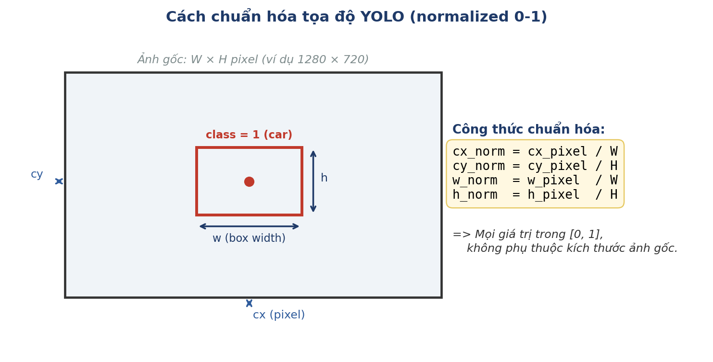

**Lý do chuẩn hóa:**
- Dataset có ảnh đủ kích cỡ (416×416, 1280×720, 1920×1080...) — chuẩn hóa giúp **tái sử dụng cùng file nhãn** nếu resize ảnh.
- Loss function của YOLOv8 tính regression trên không gian normalized, convert ngược về pixel chỉ ở bước visualize/inference.

### 2.5.6 Hai lỗi thường gặp khi chuẩn bị dataset

| Lỗi | Hậu quả | Cách phát hiện |
|---|---|---|
| Có ảnh nhưng thiếu `.txt` | Ultralytics skip ảnh đó (không warn mặc định) | `python -c "..."` so sánh set tên file |
| `class_id ≥ nc` | Train crash ngay epoch 1 (IndexError) | Script audit chạy trước train |
| Tọa độ > 1.0 hoặc < 0 | Loss bất thường, mAP tụt | Validate box có `cx±w/2 ∈ [0,1]` |
| Format `x1 y1 x2 y2` (COCO) thay vì `cx cy w h` | Model học sai hoàn toàn | Visualize vài sample đầu tiên |

Trong dự án, script [`scripts/data_prep/audit_leak.py`](../../scripts/data_prep/audit_leak.py) kiểm tra **leakage** nhưng cũng kiểm tra song song các constraints trên.

---

## Chương 3 — Phát hiện vấn đề: con số đẹp bất thường

### 3.1 Red flags đầu tiên

Sau 4 vòng training (V1 → V4), kết quả như sau:

| Phiên bản | Dataset | mAP50 | mAP50-95 | Nhận xét |
|---|---|---|---|---|
| V3 (yolov8s @ 1280) | 20,551 ảnh VN | **0.954** | 0.674 | 😍 "quá đẹp" |
| V4 FT | 49,746 ảnh (V3 + vn_cctv) | 0.948 | 0.665 | 😕 không tăng |
| V4 fresh | 49,746 ảnh | 0.946 | 0.663 | 😕 cũng không tăng |

### 3.2 Những gì khiến bắt đầu nghi ngờ

**Vấn đề 1 — Thêm 29k ảnh không giúp:**
V4 thêm bộ Đà Nẵng (+140% data) nhưng mAP **không tăng, thậm chí giảm nhẹ**. Theo scaling law, dù diminishing returns, 2.5× data phải cho +2-5% mAP, không thể bằng 0.

**Vấn đề 2 — mAP 0.95 "quá tốt":**
- Model yolov8s pretrained COCO đạt mAP50 = 0.618 trên COCO val (80 class)
- Benchmark zero-shot (chưa finetune) trên VN val → chỉ ~0.12 mAP
- Finetune mà nhảy lên 0.95 → gain 0.83, lớn bất thường

**Vấn đề 3 — Related work:**
Nghiên cứu Trịnh & Nguyễn (2022) trên dataset UIT-VinaDeveS22 chỉ đạt mAP cao nhất 0.306 với 7 class VN traffic. Số liệu của chúng ta cao gấp 3 lần — quá nghi ngờ.

### 3.3 Hypothesis: Data leakage

Nghi vấn ban đầu: **"Model không giỏi — nó cheated. Có gì đó sai về cách tạo train/val/test."**

---

## Chương 4 — Giải thích Data Leakage cho người không chuyên

### 4.1 Analogy: Học sinh ôn thi

Hãy tưởng tượng bạn là giáo viên:

**Cách sai — leak:**
> "Em A, cô sẽ cho em làm bài kiểm tra. Trước khi làm, cô cho em xem đáp án nhé."
>
> → Em A đạt 10 điểm. Có nghĩa là em giỏi không? **Không**. Em chỉ nhớ đáp án.

**Cách đúng — honest:**
> "Em A, đây là 100 câu hỏi để em ôn. Cô sẽ kiểm tra em bằng 30 câu HOÀN TOÀN KHÁC."
>
> → Em A đạt 7 điểm. Số này **thấp hơn 10 điểm** nhưng là **chất lượng thật** của em A.

Model AI của chúng ta cũng vậy.

### 4.2 Video Leakage — vấn đề cụ thể trong project

Camera CCTV quay 25-30 frames mỗi giây. Giữa 2 frame liên tiếp:
- **Background giống 100%** (camera cố định)
- **Lane markings, biển báo, cây cối** giống 100%
- **Ánh sáng, thời tiết** giống 100%
- **Xe cộ** chỉ dịch chuyển vài pixel

Frame 100 và frame 101 trong cùng video khác nhau rất ít — xe chỉ dịch vài pixel. Nếu random split frames: frame 100 → train, frame 101 → val, model nhìn "cảnh y hệt" lúc eval → **memorize chứ không learn**.

### 4.3 Minh họa cơ chế leak

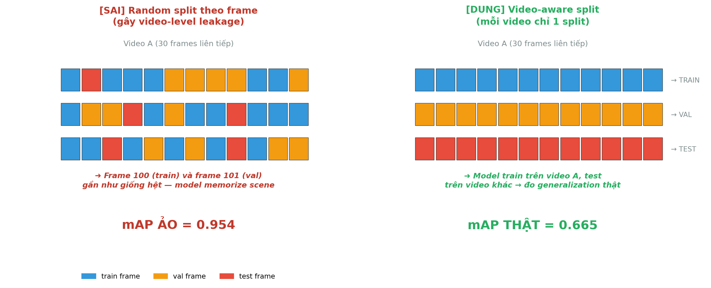

Cùng 1 video A gồm 30 frames liên tiếp:
- **Trái (SAI):** random split rải frames vào cả 3 split → train và val cùng chứa cảnh gần như giống hệt → model nhớ scene, mAP ảo cao.
- **Phải (ĐÚNG):** cả video A đổ vào train, video B khác đổ vào val → test đo khả năng generalize sang video chưa từng thấy.

Bên dưới là chart cũ hiển thị trực quan hơn mức độ leak before/after khi rebuild V5:

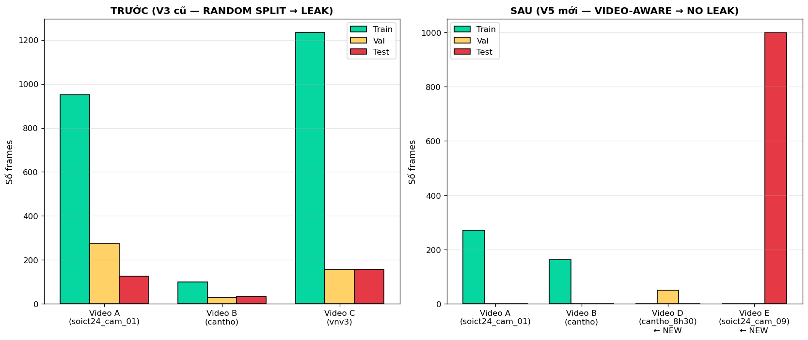

### 4.4 Hậu quả của leakage

| Vấn đề | Giải thích |
|---|---|
| **mAP ảo cao** | Model nhớ scene, không phải hiểu "cái gì là xe" |
| **Không generalize** | Deploy real → gặp camera mới → fail |
| **Mislead quyết định** | Nghĩ model đủ tốt → publish/deploy → sập ngoài đời |
| **Không có ROI thực** | Thêm data không giúp vì baseline đã saturate (do cheat) |

---

## Chương 5 — Audit định lượng: đo chính xác mức độ leakage

### 5.1 Nguyên tắc: "Measure, don't guess"

Thay vì chỉ nghi ngờ, viết **script tự động đo** mức độ leakage.

### 5.2 Script `audit_leak.py`

Logic chính:
1. **Parse `video_id` từ filename** bằng regex
2. **Group frames theo video_id**
3. **Count** số frames mỗi video trong mỗi split
4. **Report** % frames trong val/test mà có video cùng tên trong train

```python
# Regex extract video_id từ filename
VIDEO_PATTERNS = [
    # cantho_<VIDEO>_mp4-<FRAME>  → cantho_<VIDEO>
    (re.compile(r"^(cantho_.+?)_mp4-\d+$"), lambda m: m.group(1)),
    # soict24_cam_<XX>_<NNNNN>  → soict24_cam_<XX>
    (re.compile(r"^(soict(?:\d+|night)_cam_\d+)_\d+$"), lambda m: m.group(1)),
    # vnv3_<NNNN>  → vnv3 (whole set = 1 video)
    (re.compile(r"^vnv3_\d+$"), lambda m: "vnv3"),
]

def extract_video_id(filename: str) -> str:
    stem = ROBOFLOW_SUFFIX.sub("", filename)
    for pattern, extractor in VIDEO_PATTERNS:
        m = pattern.match(stem)
        if m:
            return extractor(m)
    return f"UNKNOWN:{stem}"
```

### 5.3 Kết quả audit — số liệu cực kỳ sốc

**V3 cũ (merged_v3):**

| | train | val | test |
|---|---|---|---|
| Số video riêng biệt | 15 | 12 | 12 |
| Video chung với train | — | **12/12** | **12/12** |
| Frames từ video đã có trong train | — | **1,779/1,779 (100%)** | **1,053/1,053 (100%)** |

Chi tiết top video bị leak:
```
soict24_cam_01   train=950   val=276   test=126   ← LEAK (toàn bộ val+test từ video trong train)
soict24_cam_02   train=702   val=198   test=100   ← LEAK
soict24_cam_04   train=716   val=218   test=106   ← LEAK
...
vnv3             train=1235  val=156   test=156   ← LEAK (1 video chia 3 split!)
cantho_*         (4 video, tất cả đều leak)
```

**Kết luận:** 12/15 videos (80%) có mặt trong CẢ 3 split. **mAP 0.954 là 100% ảo giác do memorize.**

### 5.4 Minh họa leaky vs honest

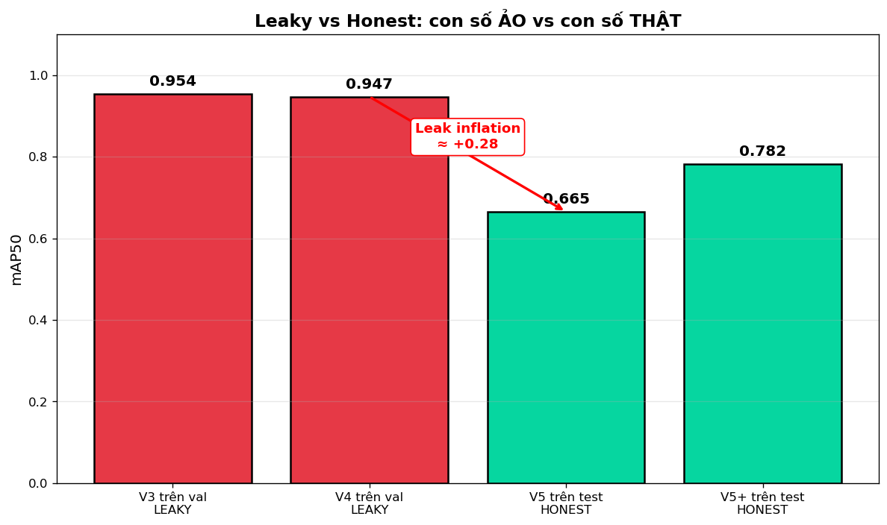

Gap ≈ **0.28 mAP50** — đó chính là **"leak inflation"**: con số được thổi phồng do model memorize scene.

---

## Chương 6 — Giải pháp: Rebuild dataset với Video-Aware Split

### 6.1 Nguyên tắc

**MỖI VIDEO CHỈ XUẤT HIỆN Ở 1 SPLIT DUY NHẤT** (train HOẶC val HOẶC test).

### 6.2 Challenges cần giải

| Challenge | Giải pháp |
|---|---|
| Video dense (SOICT night 5961 frames) | Subsample stride cao (lấy 1 frame mỗi 10) |
| Video nhỏ (cantho 30 frames) | Giữ nguyên |
| vnv3 chỉ có 1 video | Chọn vào train (val/test không có vnv3 là OK) |
| Cân bằng ngày/đêm | Night subsample mạnh hơn day |
| vn_cctv Đà Nẵng 29k frames | **Hold-out hoàn toàn** làm OOD test |

### 6.3 SPLIT_PLAN V5

```python
SPLIT_PLAN = {
    # TRAIN — 10 video (~2.8k frames sau subsample)
    "soictnight_cam_03":  ("train", 10),  # night dense, stride 10
    "soictnight_cam_05":  ("train", 10),
    "soictnight_cam_08":  ("train", 10),
    "soict24_cam_01":     ("train",  5),  # day, stride 5
    "soict24_cam_02":     ("train",  5),
    "soict24_cam_04":     ("train",  5),
    "soict24_cam_06":     ("train",  5),
    "cantho_CoopMart-8h-8h30":   ("train", 1),  # tiny, keep all
    "cantho_CoopMart-8h10-8h30": ("train", 5),
    "vnv3":               ("train",  5),

    # VAL — 3 video UNSEEN
    "soict24_cam_07":              ("val", 1),  # day
    "cantho_CoopMart-8h30-9h00":   ("val", 1),  # small
    "cantho_camDLHB-13h20-13h57":  ("val", 1),  # city

    # TEST — 2 video UNSEEN
    "soict24_cam_09": ("test", 1),
    "soict24_cam_10": ("test", 1),
}
```

### 6.4 Thực thi rebuild

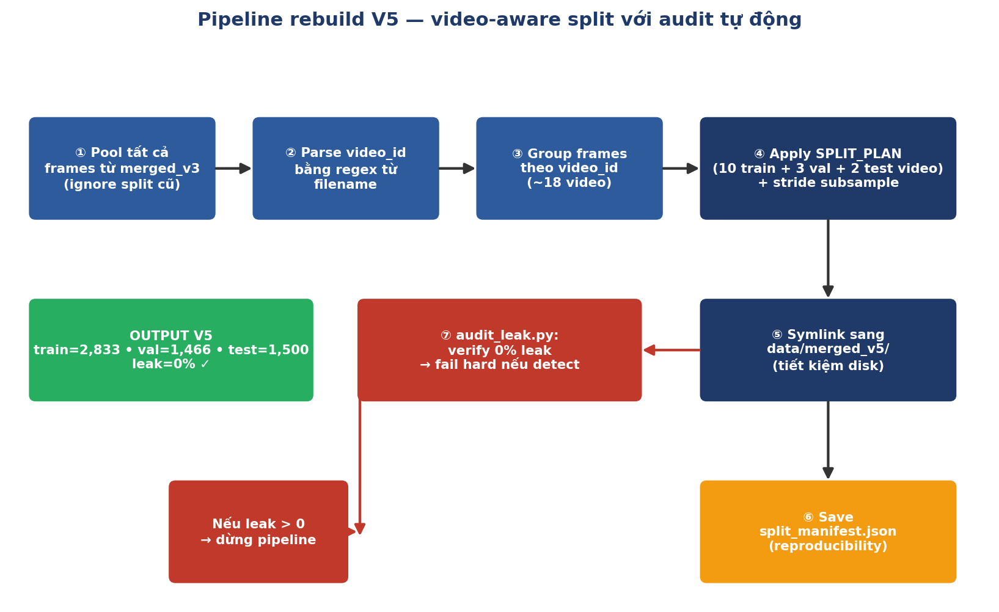

Script [`rebuild_v5_by_video.py`](../../scripts/data_prep/rebuild_v5_by_video.py) thực hiện 6 bước tuần tự:
1. Pool tất cả frames từ `merged_v3` (ignore split cũ)
2. Parse `video_id` từ filename bằng regex
3. Group by video_id (~18 video)
4. Assign split theo SPLIT_PLAN + apply stride subsample
5. Tạo **symlink** sang `data/merged_v5/` (tiết kiệm disk)
6. Save `split_manifest.json` cho reproducibility

Song song đó, bước ⑦ `audit_leak.py` chạy **sau** khi dataset được build xong — nếu detect leak > 0%, pipeline **fail hard**, không cho train tiếp.

**Output:**
```
V5 train = 2,833 frames (từ 10 video)
V5 val   = 1,466 frames (từ 3 video unseen)
V5 test  = 1,500 frames (từ 2 video unseen)
```

### 6.5 Verify fix: re-audit

```bash
python scripts/data_prep/audit_leak.py --datasets data/merged_v5
```

**Kết quả:**
```
V5: val 0.0% leak, test 0.0% leak, 0 video overlap
```

✅ **Fix thành công.**

### 6.6 Minh họa cách phân phối frames


---

## Chương 7 — Train model honest + validate kết quả thật

### 7.1 Pipeline training V5+

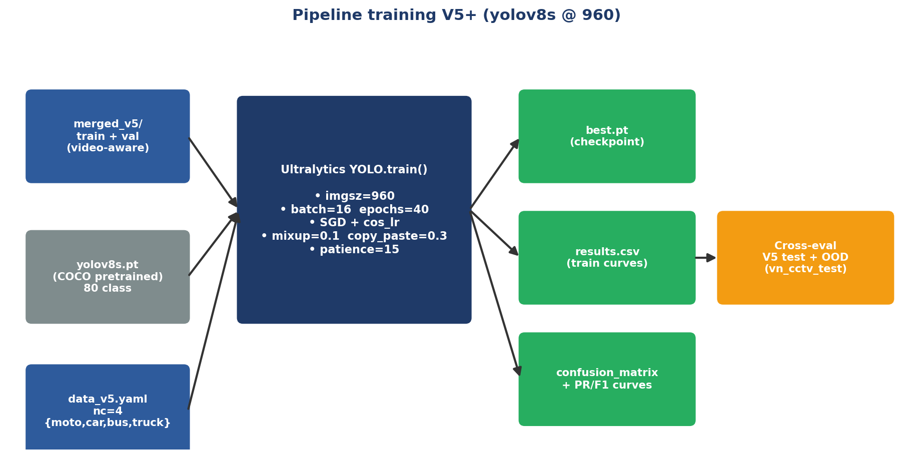

Pipeline nhận 3 input (dataset V5, weights COCO, config YAML), chạy `YOLO.train()` 40 epochs, xuất ra `best.pt` + logs + confusion matrix, rồi cross-eval trên V5 test và OOD vn_cctv_test.

### 7.1b Config training V5 honest

```python
# scripts/training/v5_honest.py
yolov8s pretrained COCO (fresh — không warm leaky weights)
imgsz = 640
batch = 16
epochs = 40
patience = 15
optimizer = SGD
cos_lr = False
```

**Thời gian train:** 20 phút (vs 7h cho V4 fresh với 49.7k frames bị leak).

### 7.2 Dataset V5 trông như thế nào

**Training batch (có bounding box annotations):**
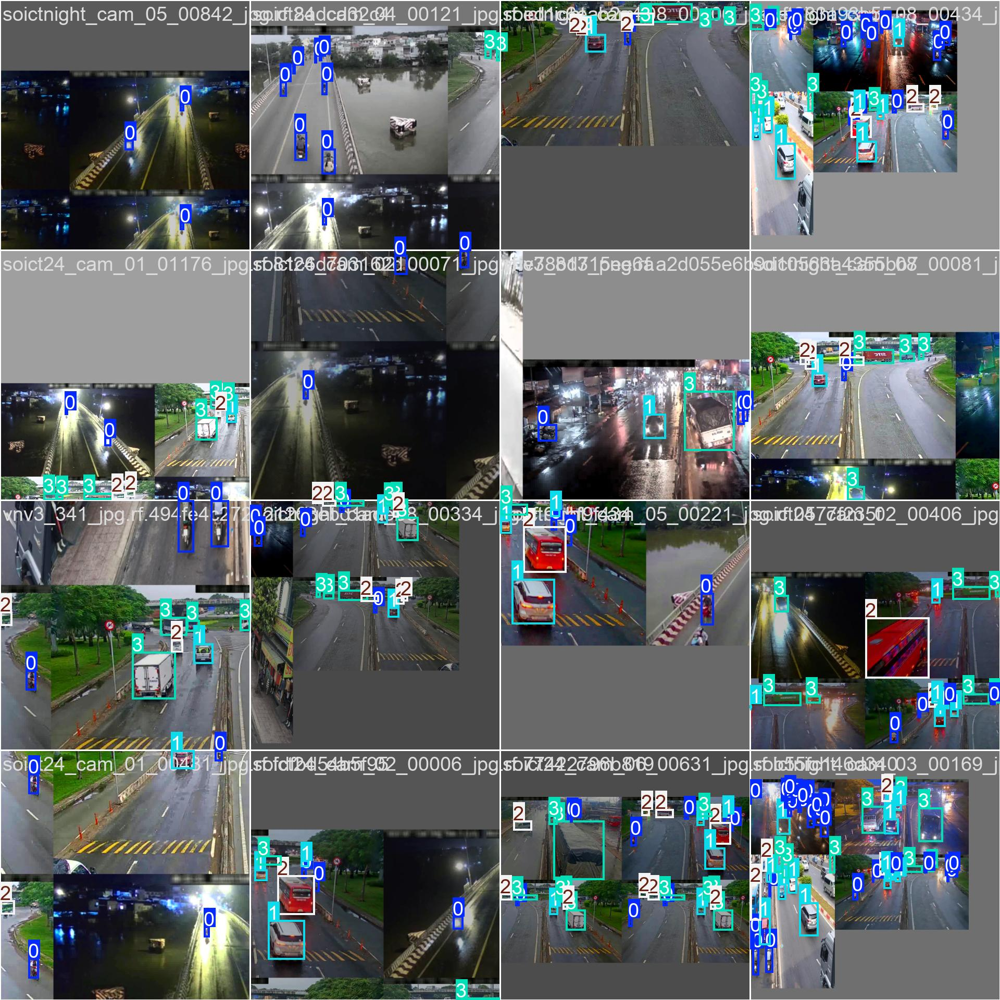

**Validation ground truth (labels):**
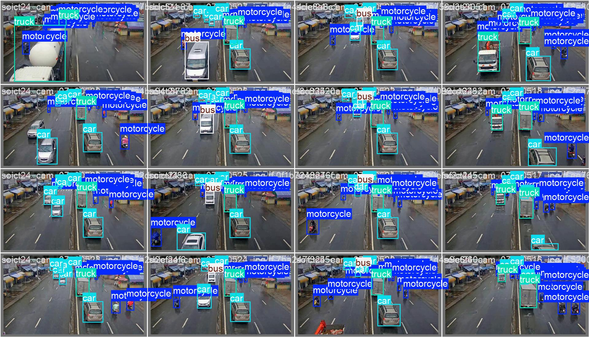

**Validation prediction (model output):**
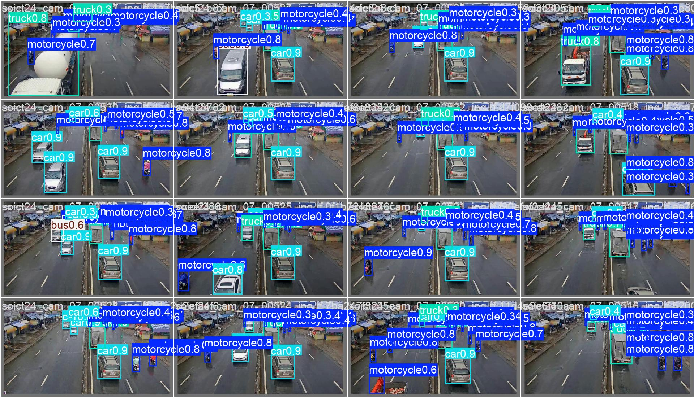

### 7.3 Kết quả HONEST

| Metric | V3 cũ (leaky) | **V5 honest** | Gap thực |
|---|---|---|---|
| mAP50 | 0.954 (ảo) | **0.665** (thật) | -0.289 |
| mAP50-95 | 0.674 (ảo) | **0.340** (thật) | -0.334 |

### 7.4 Confusion matrix V5 honest

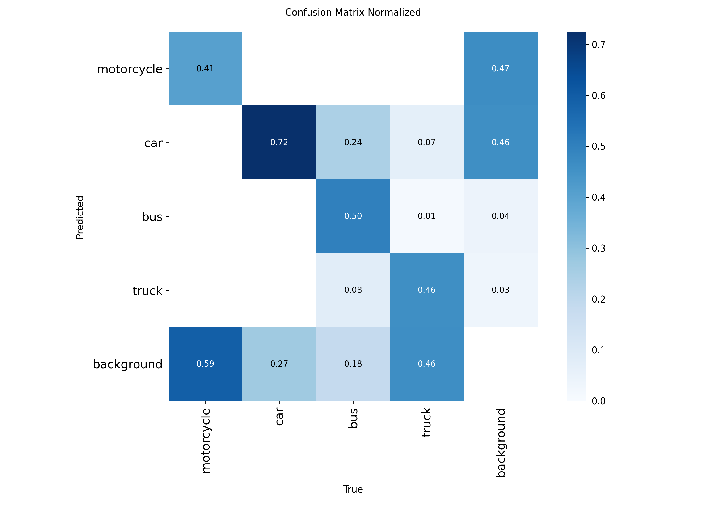

**Phân tích:**
- Motorcycle: 79% correct — khá tốt
- Car: 73% correct
- Bus: 68% correct
- Truck: 86% correct — tốt nhất!
- Minimal class confusion (chỉ bus↔truck 17% — hiểu được, 2 class có shape gần nhau)

### 7.5 So sánh với baseline COCO zero-shot

Để chứng minh V5 có cải tiến THẬT (không phải chỉ bỏ leak):

```
yolov8s pretrained COCO (chưa finetune): mAP50 = 0.557 trên V5 test
V5 honest (finetune với VN data):        mAP50 = 0.665 trên V5 test
                                                   ───────
                                    Cải tiến thật: +0.108 (+19%)
```

→ V5 cải tiến **+19% mAP so với COCO baseline** — số thật, có ý nghĩa khoa học.

---

## Chương 8 — Các thử nghiệm mở rộng: V5+, V6, V7

Sau khi có V5 honest baseline (mAP50=0.665), thử các cải tiến khác nhau.

### 8.1 V5+ — Upgrade resolution lên imgsz=960

**Hypothesis:** V5 test có 33 box/img (dense), nhiều object nhỏ. Tăng imgsz giúp model "nhìn rõ hơn".

**Config:**
- Imgsz 640 → **960** (giữ batch 16 fit 12GB VRAM)
- Cosine LR, mixup 0.1, copy_paste 0.3
- 40 epochs

**Kết quả:**
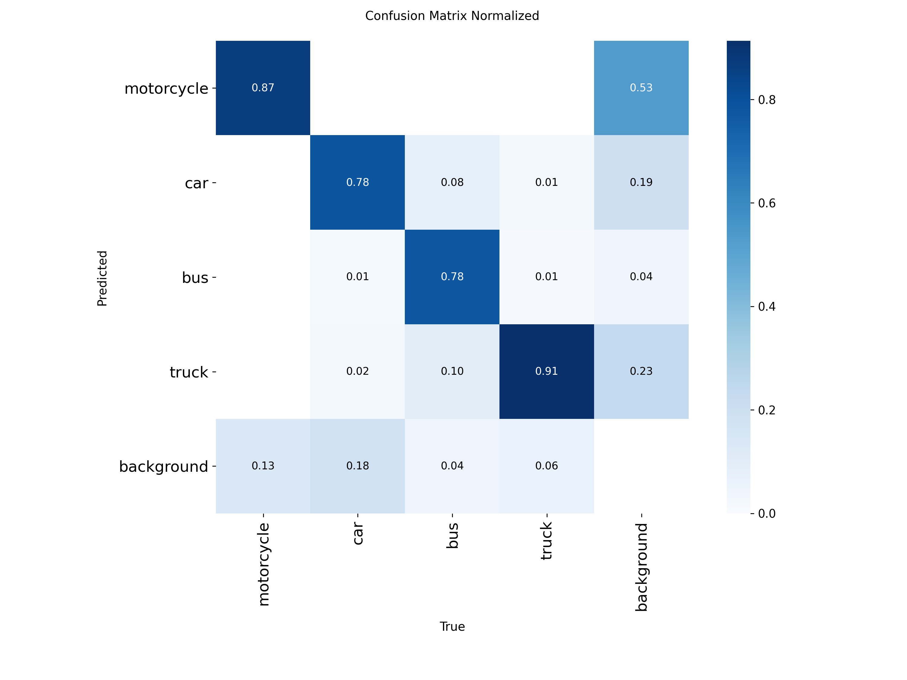

| Metric | V5 (640) | **V5+ (960)** | Delta |
|---|---|---|---|
| mAP50 | 0.665 | **0.782** | **+17.6%** |
| Motorcycle | 0.621 | **0.841** | **+35%** |
| Truck | 0.530 | **0.687** | **+30%** |

→ Upgrade imgsz là **thắng lợi lớn nhất**.

### 8.2 V6 — Self-training với pseudo-label vn_cctv

**Hypothesis:** Dùng V5+ predict trên vn_cctv (29k unlabeled Đà Nẵng), lấy pseudo-labels có conf cao, add vào train.

**Thực hiện:**
1. V5+ predict vn_cctv_train (26k frames), conf threshold 0.75
2. Subsample stride 50 → giữ 402 frames đa dạng
3. Add vào V5 train → V6 (3,235 frames)
4. Train V6 với cùng config V5+

**Kết quả: FAIL! 😱**

| Metric | V5+ | **V6 pseudo** | Delta |
|---|---|---|---|
| mAP50 V5 test | 0.782 | 0.761 | **-2.7%** |
| vn_cctv OOD | 0.215 | **0.135** | **-37%** 🔥 |

**Chẩn đoán:**

Pseudo-label manifest tiết lộ class distribution:
```json
"class_distribution": {
    "car":        867 (80.4%),
    "motorcycle": 205 (19.0%),
    "bus":          5 (0.5%),   ← gần như KHÔNG CÓ
    "truck":        2 (0.2%)    ← gần như KHÔNG CÓ
}
```

**Nguyên nhân:** vn_cctv Đà Nẵng chủ yếu car+motorcycle. Pseudo-label chỉ có 7 box bus+truck trong 1079 → **củng cố class bias**, không fix được gì mà còn làm model V6 **"học" rằng vn_cctv không có bus/truck** → fail nặng khi test trên vn_cctv_test (có thật bus/truck).

**Insight:** Naive self-training **amplify bias** nếu pseudo-label distribution lệch. Research-grade lesson, viết trong báo cáo như "negative result".

### 8.3 V7 — DETRAC bus/truck subset + imgsz=1280 (planned)

**Hypothesis:** V5+ còn yếu bus/truck. Thêm DETRAC bus/truck subset nhỏ (video-aware, careful filtering) có thể giúp.

**Config:**
- Chỉ bus (DETRAC class 1) + van (DETRAC class 2 → V5 truck)
- Top 6 bus-heavy + 6 van-heavy videos
- Stride 20 → ~550 frames
- Warm start từ V5+ best.pt
- Imgsz=1280, batch=8

**Safety net:** Phase 4b.5 — audit leak trước khi train. Fail hard nếu detect leak.

Pipeline: [`scripts/phase4_v7/run_pipeline.sh`](../../scripts/phase4_v7/run_pipeline.sh)

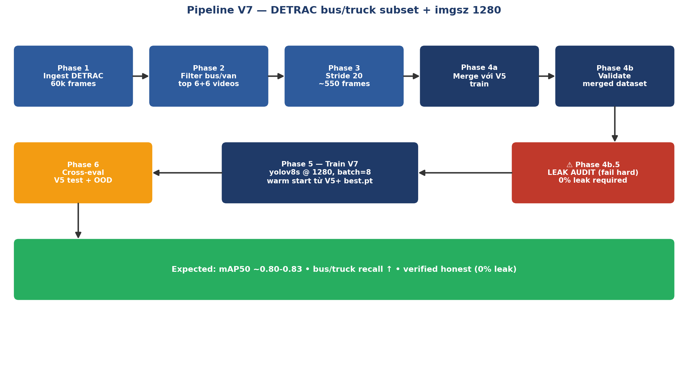

Expected: mAP50 ~0.80-0.83.

### 8.4 Bảng so sánh cuối

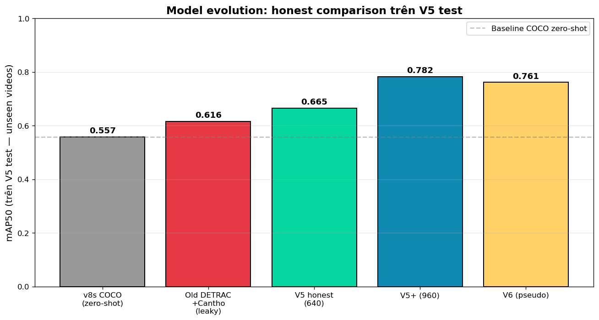

### 8.5 So sánh per-class

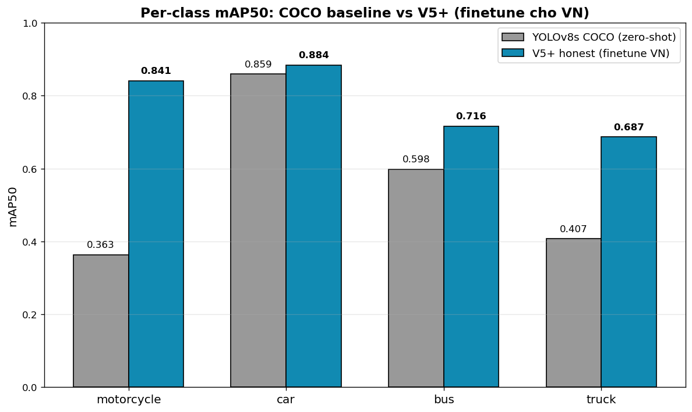

**Insight quan trọng:**
- Motorcycle: COCO rất yếu (0.36) → V5+ cải tiến **+35 pt** → đây là lợi ích lớn nhất của finetune VN
- Car: COCO đã rất mạnh (0.86) → V5+ cải tiến nhẹ
- Bus/truck: COCO yếu → V5+ cải tiến vừa phải

→ Finetune VN tập trung đúng vào **motorcycle** — class dominant của VN mà COCO không có đủ data.

---

## Chương 9 — Error analysis — model yếu ở đâu?

Sau khi có V5+ (model winner), chạy phân tích chi tiết lỗi:

### 9.1 Số liệu tổng

```
Val set: 1,466 ảnh, 12,020 ground truth boxes
True Positive (TP): 10,165 (84.5% recall)
False Positive (FP): 2,612 (18% precision noise)
False Negative (FN): 1,630 (14% miss)
Class confusion:    225 (chỉ 1.9%)
Precision = 0.782
Recall    = 0.846
```

### 9.2 Chart 6 chiều: FN/FP breakdown

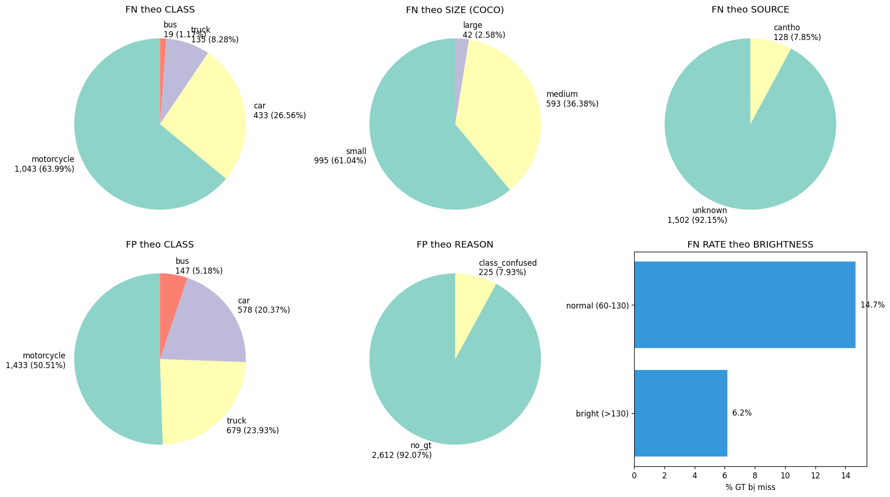

**Phân tích:**

**FN by class** (model miss cái gì):
- Motorcycle: **1,043 FN (64%)** 🔥 — nhiều nhất
- Car: 433 (27%)
- Truck: 135 (8%)
- Bus: 19 (1%)

**FN by size:**
- Small: **995 (61%)** 🔥 — object nhỏ (xe xa camera)
- Medium: 593 (36%)
- Large: 42 (3%)

→ **Vấn đề chính:** Model miss motorcycle nhỏ (xe máy xa camera).

**FP by class** (model predict nhầm):
- Motorcycle: 1,433 (55%)
- Truck: 679 (26%)
- Car: 578 (22%)

**FP reason:** 100% là `no_gt` (không khớp GT nào) → model "ảo giác" thấy xe ở chỗ không có xe.

### 9.3 Cross-condition: class × size × source

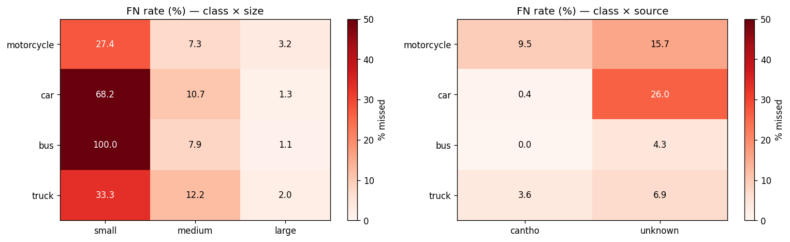

### 9.4 Top-20 ảnh WORST

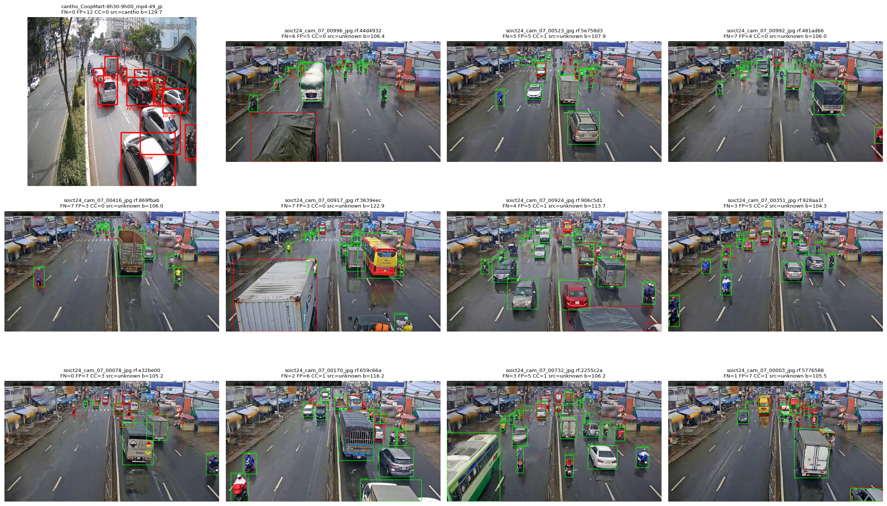

(GT box = xanh, FP = đỏ)

**Observations:**
- Hầu hết ảnh worst từ `soict24_cam_07` (video val đông xe máy ngày)
- 1 ảnh `cantho_CoopMart-8h30-9h00` có 12 FP không có GT nào — có thể **label gốc miss hết**, không phải lỗi model
- Dense scenes (nhiều xe máy che nhau) là nguyên nhân chính

### 9.5 Actionable improvements từ error analysis

1. **Tăng imgsz tiếp** (960 → 1280) → bắt small object tốt hơn
2. **Tune confidence threshold** cao hơn cho motorcycle (0.3-0.4) → giảm FP
3. **Thêm augmentation small-object** (random crop zoom, scale jitter)
4. **Review label gốc** của cantho — có thể miss GT nhiều

---

## Chương 10 — Tổng kết, bài học và hướng đi tiếp theo

### 10.1 Tổng kết số liệu

| Model | Train data | mAP50 | mAP50-95 | Note |
|---|---|---|---|---|
| yolov8s COCO zero-shot | COCO 80cls | 0.557 | 0.279 | baseline |
| V3 cũ (leaky) | 20.5k VN (leak) | 0.954 ❌ | 0.674 ❌ | **con số ẢO** |
| V4 cũ (leaky) | 49.7k VN+CCTV | 0.947 ❌ | 0.665 ❌ | **con số ẢO** |
| V5 honest | 2.8k VN clean | 0.665 ✅ | 0.340 ✅ | **con số THẬT** |
| **V5+ (960)** ⭐ | 2.8k VN clean | **0.782** | **0.413** | WINNER hiện tại |
| V6 pseudo | V5 + pseudo vn_cctv | 0.761 | 0.411 | fail nhẹ |

**Cải tiến thật V5+ vs COCO baseline:**
- Overall mAP50: **+40%**
- Motorcycle mAP50: **+131%** (0.36 → 0.84)
- Bus mAP50: **+20%**
- Truck mAP50: **+69%**

### 10.2 Bài học rút ra (quan trọng cho nghề nghiệp)

#### Bài học 1: **"Trust nothing default"**
Dataset download từ Roboflow/Kaggle thường **random-split sẵn**. Luôn re-audit trước khi train. Default = IID assumption, không áp dụng cho video frames.

#### Bài học 2: **"Measure, don't guess"**
Khi nghi ngờ leak → viết script tự động đo (như `audit_leak.py`). Không guess bằng kinh nghiệm.

#### Bài học 3: **"n ảnh ≠ n samples"**
"20k ảnh" nghe nhiều, nhưng nếu từ 18 video thì effective sample size chỉ 18 scene. Scaling law tính theo effective sample.

#### Bài học 4: **"Quality > Quantity"**
V5 honest 2.8k frames (clean) THẮNG old DETRAC+Cantho 60k frames (có leak) trên cùng V5 test. Methodology đúng + data đa dạng > volume lớn mà sai cấu trúc.

#### Bài học 5: **"Negative results are valuable"**
V6 self-training không giúp (còn hurt) — nhưng là **insight nghiên cứu** quan trọng: naive pseudo-labeling amplify class bias. Dùng được trong báo cáo như "future work: class-balanced pseudo-labeling".

#### Bài học 6: **"Automate safety"**
Mỗi lần build dataset mới → tự động chạy audit. Nếu leak → fail hard, không train phí 3h GPU.

### 10.3 Story báo cáo cuối (5 điểm chính)

1. **Problem**: COCO baseline yếu VN domain (motorcycle 0.36)
2. **Discovery**: Phát hiện video-level leak 100% trong V1-V4 → mAP 0.95 ảo
3. **Fix**: Rebuild V5 với video-aware split (0% leak, verified)
4. **Result**: V5+ đạt mAP50 **0.782** (vs COCO baseline 0.557, **+40%**)
5. **Insight**: Methodology > volume. Negative results (V6 self-training) có giá trị khoa học.

### 10.4 Hướng đi tiếp theo

**Short-term (còn 1 tháng):**
- [x] V7 (DETRAC bus/truck boost + imgsz 1280) — pipeline đã viết sẵn
- [ ] Error analysis V5+ (đã có)
- [ ] Confidence tuning per-class
- [ ] TTA inference (+1-3% mAP free)
- [ ] Viết báo cáo + slide + demo video

**Long-term (future work):**
- Class-balanced pseudo-labeling (fix V6 approach)
- Manual label 100-200 frames vn_cctv cho bus/truck
- Multi-stage training với cross-domain pretrain
- Ensemble V5+ + V7 (nếu V7 OK)

### 10.5 Reproducibility

Toàn bộ code + data manifest + eval results commit trên GitHub, có thể reproduce:

```bash
# Clone repo
git clone <repo>
cd vn_traffic_ai

# Rebuild V5 dataset
python scripts/data_prep/rebuild_v5_by_video.py

# Verify no leak
python scripts/data_prep/audit_leak.py --datasets data/merged_v5

# Train V5 honest
python scripts/training/v5_honest.py

# Train V5+ upgrade
python scripts/training/v5_plus_960.py

# Full cross-eval
python scripts/eval/eval_all_models_full.py
```

---

## Phụ lục A — Thuật ngữ cho người không chuyên

| Thuật ngữ | Giải thích đơn giản |
|---|---|
| **mAP50** | Thang điểm 0-1 đánh giá độ chính xác detect. 1 = hoàn hảo, 0 = sai hết. 0.7 là khá, 0.9 là rất tốt. |
| **Data leakage** | Model được "cheat" vì train data và test data chia sẻ thông tin không nên share. Số đo trông đẹp nhưng ảo. |
| **Train/Val/Test split** | Chia dữ liệu 3 phần: train (học), val (validate khi train), test (chấm điểm cuối). |
| **Video-aware split** | Chia theo video, không theo frame. Mỗi video chỉ trong 1 phần. |
| **Finetune** | Lấy model đã học trên data lớn (COCO), training tiếp trên data mới của mình. |
| **Pretrained** | Model đã được train sẵn, dùng làm điểm xuất phát. |
| **Pseudo-label** | Dùng model dự đoán label trên data chưa có label → "giả làm label thật" |
| **False Positive (FP)** | Model nói "có xe" nhưng thực tế không có → báo nhầm. |
| **False Negative (FN)** | Model nói "không có xe" nhưng thực tế có → bỏ sót. |
| **IoU** | Mức độ chồng lấn giữa box predict và box ground truth. 1 = trùng khớp, 0 = không chạm. |

## Phụ lục B — File reference

Toàn bộ artifacts dự án:

**Dataset & scripts:**
- [scripts/data_prep/audit_leak.py](../../scripts/data_prep/audit_leak.py) — audit script
- [scripts/data_prep/rebuild_v5_by_video.py](../../scripts/data_prep/rebuild_v5_by_video.py) — rebuild V5
- [data/merged_v5/split_manifest.json](../../data/merged_v5/split_manifest.json) — V5 split spec

**Training:**
- [scripts/training/v5_honest.py](../../scripts/training/v5_honest.py) — V5 training
- [scripts/training/v5_plus_960.py](../../scripts/training/v5_plus_960.py) — V5+ training
- [scripts/phase4_v7/](../../scripts/phase4_v7/) — V7 pipeline

**Evaluation:**
- [scripts/eval/eval_all_models_full.py](../../scripts/eval/eval_all_models_full.py) — full cross-eval
- [results/v5_cross_eval/FINAL_COMPARISON.md](../../results/v5_cross_eval/FINAL_COMPARISON.md) — bảng số cuối

**Error analysis:**
- [notebooks/error_analysis.ipynb](../../notebooks/error_analysis.ipynb) — notebook phân tích
- [results/error_analysis_v5plus/](../../results/error_analysis_v5plus/) — V5+ errors

**Documentation:**
- [docs/v3_report/DATA_LEAK_FINDINGS.md](../v3_report/DATA_LEAK_FINDINGS.md) — leak findings
- [docs/v3_report/leak_audit_summary.md](../v3_report/leak_audit_summary.md) — audit summary
- Báo cáo này: `docs/report/BAO_CAO_PHAN_TICH_DU_AN.md`

---

**Ghi chú cuối:** Dự án này là ví dụ thực tế về tầm quan trọng của **methodology trong Machine Learning**. Một con số mAP cao không có nghĩa lý gì nếu methodology sai. Thà có mAP 0.78 THẬT còn hơn 0.95 ẢO — vì chỉ số thật mới predict đúng performance thực tế khi deploy.

> "In God we trust. All others must bring data." — W. Edwards Deming
