# CHƯƠNG 3 — PHƯƠNG PHÁP ĐỀ XUẤT

Chương này trình bày phương pháp hệ thống phát hiện và đếm phương tiện giao thông Việt Nam được đề xuất trong đồ án. Nội dung tập trung mô tả thiết kế cuối cùng — bao gồm dữ liệu, mô hình, thuật toán theo vết và tiêu chí đánh giá — mà không đi sâu vào các cấu hình thăm dò hay thí nghiệm phụ (các nội dung này được trình bày trong Chương 4).

## 3.1 Tổng quan hệ thống

### 3.1.1 Kiến trúc hai luồng

Hệ thống được thiết kế theo hai luồng xử lý độc lập về mục đích nhưng chia sẻ cùng một mô hình phát hiện:

- **Luồng huấn luyện (offline):** chuẩn hóa ảnh và nhãn từ các nguồn dữ liệu, chia tập theo video, fine-tune mô hình YOLOv8 từ trọng số pretrained COCO, chọn checkpoint tốt nhất dựa trên validation.
- **Luồng suy luận (online):** đọc video theo frame, chạy mô hình phát hiện trên từng frame, liên kết các detection giữa các frame bằng tracker ByteTrack, phát hiện giao cắt vạch đếm và xuất kết quả.

### 3.1.2 Pipeline xử lý video

Pipeline suy luận có thể biểu diễn như sau:

```
Video đầu vào
    ↓
YOLOv8s detect  (bounding box, class, confidence)
    ↓
ByteTrack       (gán track ID bền vững qua các frame)
    ↓
Counter         (phát hiện giao cắt vạch ảo + hướng di chuyển)
    ↓
CSV sự kiện  +  Video chú thích
```

Ở đây YOLOv8s là mạng CNN chính thực hiện phát hiện; ByteTrack là thuật toán theo vết (không phải mạng CNN thứ hai) chỉ liên kết các detection liên tiếp dựa trên IoU và cosine similarity.

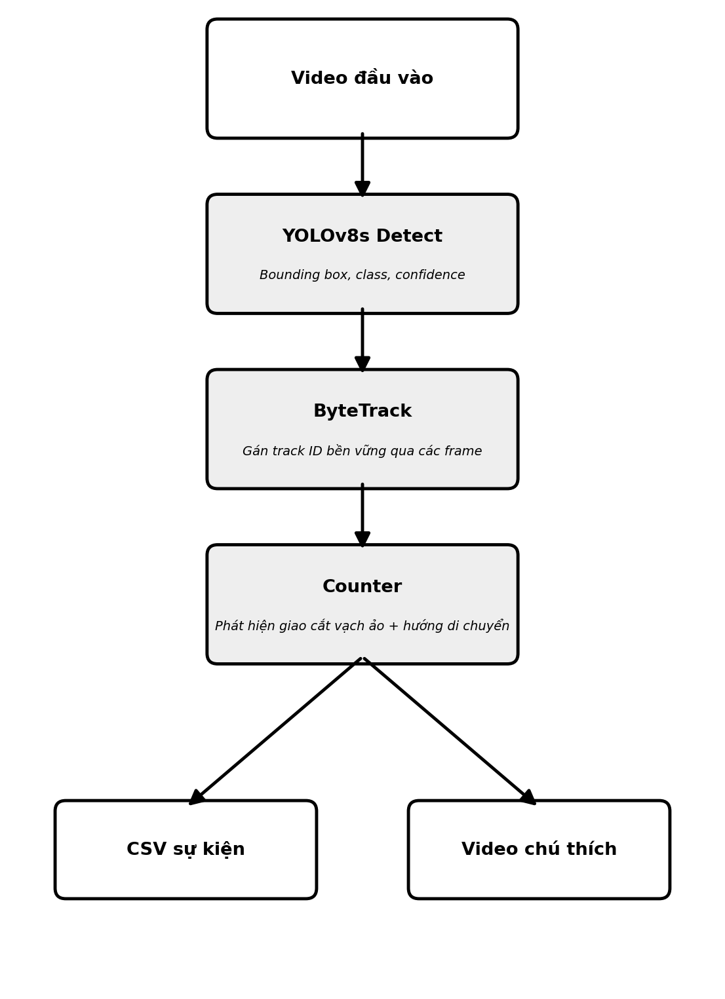

## 3.2 Dữ liệu và quy ước nhãn

### 3.2.1 Nguồn dữ liệu

Phương pháp đề xuất sử dụng bốn nguồn dữ liệu giao thông Việt Nam cho tập huấn luyện và đánh giá:

| Nguồn | Số frame raw | Số video | Mô tả |
|---|---|---|---|
| SOICT 2024 (ngày) | 6.892 | 7 camera | giao lộ ban ngày tại TP.HCM |
| SOICT Night | 13.834 | 3 camera | giao lộ ban đêm |
| Cần Thơ | 1.110 | 4 video | phố Cần Thơ, nhiều điều kiện |
| VNv3 | 1.547 | 1 video | giao thông Việt Nam |
| **Cộng** | **23.383** | **15 video** | — |

Ngoài bốn nguồn trên, video CCTV Đà Nẵng (29.195 frame, 1 video) được **tách riêng** làm tập dữ liệu ngoài phân phối (out-of-distribution — OOD) để đánh giá khả năng tổng quát hoá của mô hình sang domain CCTV khác địa điểm.

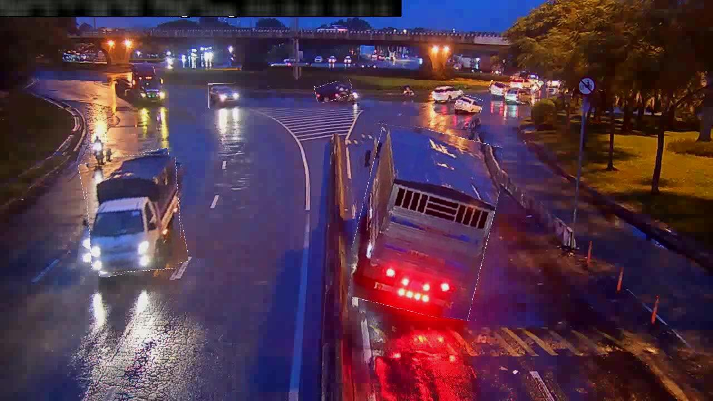

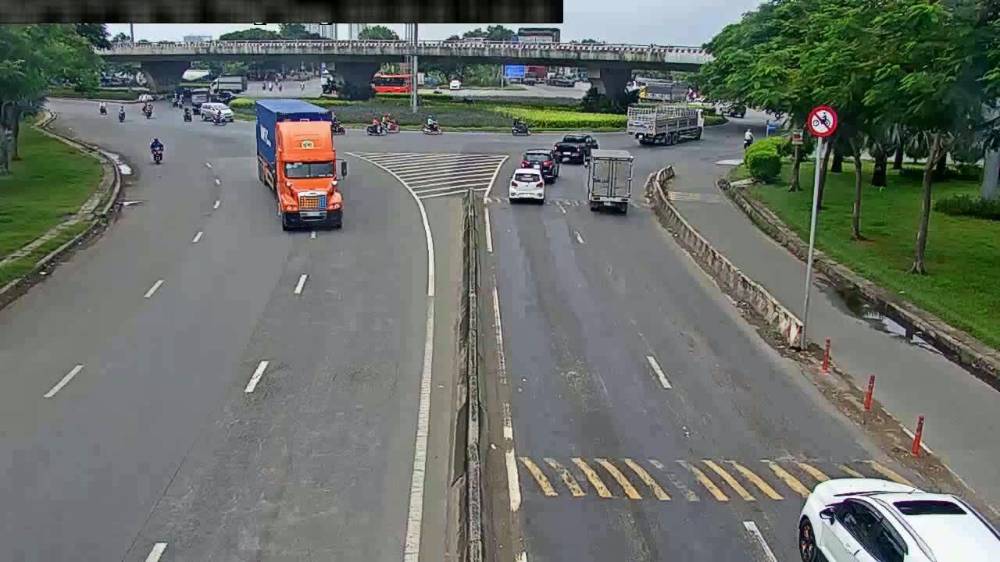

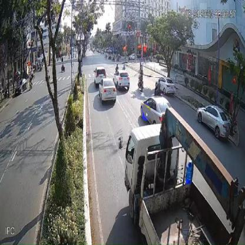

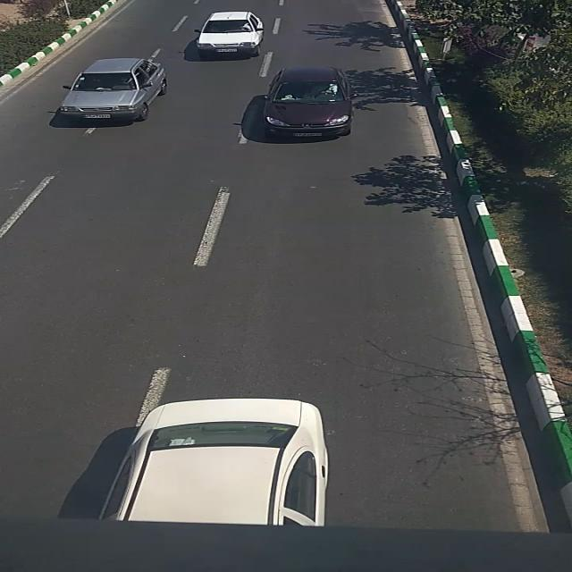

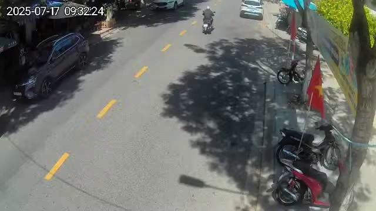

### 3.2.2 Schema nhãn 4 lớp

Tất cả nguồn dữ liệu được quy đổi về cùng một schema 4 lớp phương tiện phù hợp với đặc thù giao thông Việt Nam:

| Class ID | Tên | Phạm vi |
|---|---|---|
| 0 | motorcycle | xe máy, scooter |
| 1 | car | ô tô con, SUV |
| 2 | bus | xe buýt, xe khách |
| 3 | truck | xe tải, xe thùng |

Các lớp khác xuất hiện trong dữ liệu nguồn (bicycle, auto-rickshaw, van, person, …) được **loại bỏ hoàn toàn chứ không gộp sang lớp gần nhất về ngữ nghĩa**. Nguyên tắc này nhằm tránh gây nhầm lớp — ví dụ ánh xạ van sang truck có thể làm mô hình học nhầm hình dáng (van gần SUV/minivan hơn xe tải thùng).

### 3.2.3 Định dạng nhãn YOLO

Mỗi ảnh đi kèm một tệp nhãn `.txt` cùng tên trong thư mục nhãn song song. Mỗi dòng trong tệp nhãn biểu diễn một bounding box theo định dạng:

```
class_id  cx  cy  w  h
```

trong đó `(cx, cy)` là toạ độ tâm hộp, `(w, h)` là chiều rộng và chiều cao hộp, **đã được chuẩn hoá về khoảng `[0, 1]`** theo kích thước ảnh gốc. Chuẩn hoá cho phép tái sử dụng cùng tệp nhãn với mọi độ phân giải resize.

![FIG:Hình 3.7 — Minh hoạ hệ toạ độ YOLO trên ảnh thực từ bộ SOICT 2024 (camera ngày): origin ở góc trên trái, trục +X sang phải, +Y xuống dưới; tâm bbox (cx, cy) và kích thước (w, h) đều chuẩn hoá trong khoảng [0, 1] theo kích thước ảnh gốc](../report/assets/yolo_format/yolo_coord_system_vn.png)

### 3.2.4 Chiến lược kiểm tra chất lượng dữ liệu

Phương pháp đề xuất áp dụng **chiến lược kiểm tra hai tầng** trước mỗi lần huấn luyện, cả hai tầng đều phải PASS mới cho phép training bắt đầu (fail-hard):

**Tầng 1 — Kiểm tra toàn vẹn nhãn** (`validate_labels.py`): kiểm tra 7 ràng buộc chất lượng ở cấp độ từng bounding box:

| # | Ràng buộc | Vi phạm sẽ gây |
|---|---|---|
| 1 | Mỗi ảnh có tệp `.txt` tương ứng | Ultralytics skip ảnh (không warn) |
| 2 | `class_id` ∈ `[0, nc-1]` | Train crash IndexError epoch 1 |
| 3 | `(cx, cy, w, h)` ∈ `[0, 1]` | Loss function bất thường |
| 4 | `w > 0` và `h > 0` (bbox không suy biến) | Model học noise |
| 5 | Bbox không vượt biên ảnh | Gradient không ổn định |
| 6 | Mỗi dòng đúng format "class cx cy w h" | Parse error |
| 7 | Đếm số ảnh "background" (nhãn rỗng) | Hint data imbalance nếu quá nhiều |

Kết quả validation lưu vào tệp JSON (vd `label_validation_v5.json`) kèm phân bố lớp để làm bằng chứng tái lập.

**Tầng 2 — Kiểm tra rò rỉ cấp video** (`audit_leak.py`, trình bày chi tiết trong §3.3): đảm bảo không có video nào xuất hiện trong nhiều split cùng lúc.

**Căn cứ thiết kế hai tầng độc lập:**
- Tầng 1 (bounding box) và tầng 2 (video-level) đo hai loại lỗi hoàn toàn khác nhau — vi phạm tầng này không bao hàm tầng kia.
- Mỗi tầng là một script độc lập, chạy nhanh (vài giây đến vài chục giây cho dataset V5), có thể tích hợp vào pipeline CI/CD của dự án.
- Ultralytics tự kiểm tra một phần ràng buộc toàn vẹn khi quét dataset lần đầu (cảnh báo trên console + lưu vào `.cache`), nhưng chỉ warn-and-skip chứ không fail-hard. Script `validate_labels.py` bổ sung cơ chế fail-hard chủ động để kiểm soát chất lượng trước khi tốn tài nguyên GPU.

## 3.3 Chia tập theo video và kiểm soát rò rỉ

### 3.3.1 Vấn đề của việc chia ngẫu nhiên theo frame

Camera CCTV cố định quay 25–30 frame mỗi giây, giữa hai frame liên tiếp:
- Background giống nhau gần như hoàn toàn (camera không di chuyển)
- Lane marking, biển báo, cây cối giữ nguyên
- Ánh sáng và thời tiết chỉ thay đổi rất chậm
- Phương tiện di chuyển vài pixel

Hai frame cách nhau 0,04 giây về bản chất là **hai bản sao gần như y hệt**. Nếu chia ngẫu nhiên theo frame, một frame vào train và frame kế tiếp vào test, mô hình sẽ "ghi nhớ cảnh" thay vì học khái niệm phương tiện — dẫn đến chỉ số đánh giá cao giả tạo (data leakage).

### 3.3.2 Nguyên tắc chia theo video

Phương pháp đề xuất **lấy video ID làm đơn vị chia** — mỗi video chỉ xuất hiện trong **một split duy nhất** (train HOẶC val HOẶC test). Nguyên tắc này đảm bảo mô hình được đánh giá trên các cảnh (scene) hoàn toàn chưa từng gặp trong huấn luyện.

### 3.3.3 Cấu hình chia V5

Áp dụng nguyên tắc trên, 15 video được chia như sau:

| Split | Số video | Số frame (sau lấy mẫu) | Danh sách video |
|---|---|---|---|
| **Train** | 10 | 2.833 | soictnight_cam_03/05/08, soict24_cam_01/02/04/06, cantho_CoopMart-8h-8h30, cantho_CoopMart-8h10-8h30, vnv3 |
| **Val** | 3 | 1.466 | soict24_cam_07, cantho_CoopMart-8h30-9h00, cantho_camDLHB-13h20-13h57 |
| **Test** | 2 | 1.500 | soict24_cam_09, soict24_cam_10 |

### 3.3.4 Chiến lược lấy mẫu để giảm dư thừa

Vì các video dense (hàng nghìn frame liên tiếp) tạo ra sự dư thừa cao, phương pháp áp dụng lấy mẫu stride theo nguyên tắc:

| Loại video | Stride | Lý do |
|---|---|---|
| Camera đêm SOICT (nhiều frame) | 10 | Giảm dư thừa 90% |
| Camera ngày SOICT, VNv3, cantho_8h10-8h30 | 5 | Giữ đa dạng nhưng giảm dư thừa |
| Video rất ngắn (cantho_CoopMart-8h-8h30) | 1 | Giữ nguyên vì đã nhỏ |
| Validation và test | 1 | Giữ nguyên để tối đa tín hiệu đánh giá |

### 3.3.5 Xác minh không rò rỉ

Sau khi chia, script `audit_leak.py` chạy để xác nhận:
- 0 video giao giữa các tập
- 0% frame val/test thuộc video có trong train

Kết quả audit được lưu vào tệp JSON (ví dụ `leak_audit_v5.json`) kèm theo tệp manifest (`split_manifest.json`) ghi chính xác video nào thuộc split nào. Đây là bằng chứng tái lập cho methodology.

## 3.4 Tiền xử lý và tăng cường dữ liệu

### 3.4.1 Pipeline tiền xử lý

Mỗi ảnh training được xử lý qua bốn bước trước khi đưa vào mạng:

1. **Letterbox resize**: ảnh được resize về `960 × 960` giữ nguyên tỉ lệ khung hình gốc; phần trống được đệm màu xám `(114, 114, 114)` để hình dạng phương tiện không bị méo.
2. **Chuyển thứ tự kênh màu**: từ BGR (OpenCV mặc định) sang RGB (YOLOv8 yêu cầu).
3. **Chuẩn hoá pixel**: giá trị `[0, 255]` được chia 255 để đưa về `[0.0, 1.0]` float32.
4. **Cache metadata**: ở lần huấn luyện đầu, Ultralytics quét dataset và lưu metadata vào tệp `.cache` cạnh thư mục nhãn; các lần sau đọc trực tiếp từ cache.

Mọi phép biến đổi hình học (lật ngang, co giãn, tịnh tiến, mosaic) đều **cập nhật bounding box đồng bộ** với ảnh. Augmentation chỉ áp dụng cho tập train; validation và test giữ nguyên để đo lường phản ánh đúng phân phối dữ liệu.

### 3.4.2 Lựa chọn độ phân giải đầu vào

Phương pháp đề xuất sử dụng **imgsz = 960** cho cả huấn luyện và suy luận. Căn cứ chọn:

- **Phân phối độ phân giải nguồn**: 85% dữ liệu đến từ SOICT có kích thước gốc `1280 × 720`. Imgsz 960 giữ được chi tiết object nhỏ (xe máy ở xa camera) mà không upscale quá mức ảnh nhỏ còn lại (416×416 của cantho, 640×640 của VNv3).
- **Ràng buộc phần cứng**: với GPU 12 GB VRAM, imgsz 960 vẫn fit batch 16, cho phép gradient estimate ổn định hơn batch 8 (nếu dùng imgsz 1280 phải giảm batch xuống 8).
- **Chi phí tính toán cân bằng**: pixel count ở 960 là 2,25× so với 640, nhưng gain về detection object nhỏ đáng kể hơn chi phí thêm.

### 3.4.3 Chiến lược tăng cường dữ liệu

Phương pháp kết hợp các phép tăng cường mặc định của Ultralytics YOLOv8 với một số thiết lập bổ sung phù hợp với đặc thù dữ liệu giao thông Việt Nam (cảnh đông, nhiều phương tiện che khuất, mất cân bằng lớp).

**(a) Tăng cường mặc định được giữ nguyên** (Bảng 3.1):

| Tham số | Giá trị | Ý nghĩa |
|---|---|---|
| `hsv_h` | 0.015 | Thay đổi nhẹ sắc độ, giảm phụ thuộc màu đặc trưng camera |
| `hsv_s` | 0.7 | Thay đổi độ bão hoà |
| `hsv_v` | 0.4 | Thay đổi độ sáng, giúp học nhiều điều kiện chiếu sáng |
| `translate` | 0.1 | Tịnh tiến ±10%, giảm thiên lệch vị trí |
| `scale` | 0.5 | Co giãn ±50%, tăng độ bền với kích thước |
| `fliplr` | 0.5 | Lật ngang xác suất 50% |
| `flipud` | 0.0 | **Không lật dọc** (không hợp lý với camera giao thông) |
| `mosaic` | 1.0 | Luôn ghép 4 ảnh thành 1, tăng đa dạng bối cảnh |
| `close_mosaic` | 10 | Tắt mosaic ở 10 epoch cuối |

**(b) Thiết lập bổ sung cho dữ liệu VN** (Bảng 3.2):

| Tham số | Giá trị | Lý do bổ sung |
|---|---|---|
| `mixup` | 0.1 | Trộn hai ảnh training với xác suất 10% → tạo cảnh dense hơn, giúp model học robust với scene đông phương tiện của VN |
| `cos_lr` | True | Lịch learning rate cosine (mặc định YOLOv8 là linear) phù hợp với dataset nhỏ (2.833 frame), giúp learning rate giảm mượt hơn giai đoạn cuối |
| `lr0` | 0.005 | Learning rate ban đầu thấp hơn mặc định (0.01) phù hợp fine-tune từ COCO pretrained với dataset nhỏ |

**(c) Validation và test**: chỉ áp dụng letterbox resize, chuyển kênh và chuẩn hoá; **không** áp dụng mixup, mosaic, flip hay bất kỳ augmentation nào — để mAP đo được phản ánh đúng phân phối gốc.

## 3.5 Mô hình phát hiện YOLOv8s

### 3.5.1 Lý do chọn YOLOv8s

YOLOv8s là phiên bản small (nhỏ) trong họ YOLOv8 của Ultralytics, có đặc điểm:

- **Số tham số**: 11,1 triệu (nhỏ gọn, phù hợp triển khai edge/mobile)
- **GFLOPs**: 28,6
- **Kiến trúc anchor-free**, backbone CSPDarknet, neck PAN-FPN, head Decoupled Head
- **Cân bằng tốc độ/độ chính xác**: nhanh hơn YOLOv8m/l và đủ chính xác cho bài toán 4 lớp

### 3.5.2 Cấu hình huấn luyện (Bảng 3.3)

| Hạng mục | Giá trị |
|---|---|
| Trọng số khởi tạo | `yolov8s.pt` (pretrained COCO 80 lớp) |
| Dataset | `data/merged_v5/` (15 video, video-aware split) |
| Số lớp output | 4 (motorcycle, car, bus, truck) |
| Optimizer | SGD |
| Learning rate ban đầu | 0.005 |
| Lịch learning rate | Cosine (`cos_lr=True`) |
| Momentum | 0.937 (mặc định) |
| Weight decay | 0.0005 (mặc định) |
| Epochs tối đa | 40 |
| Patience early stop | 15 |
| Batch size | 16 |
| Imgsz | 960 |
| Device | NVIDIA RTX 3500 Ada Laptop GPU (12 GB VRAM) |
| Precision | AMP (FP16 mixed) |
| Seed | 42 |

### 3.5.3 Hàm mất mát

YOLOv8 sử dụng ba thành phần loss kết hợp:

- **Box loss** (regression): CIoU loss cho bounding box
- **Classification loss**: Binary Cross-Entropy có class weights
- **DFL (Distribution Focal Loss)**: regression chính xác hơn cho box borders

Trọng số mặc định `box=7.5`, `cls=0.5`, `dfl=1.5` được giữ nguyên.

### 3.5.4 Tiêu chí lựa chọn checkpoint

Checkpoint tốt nhất được chọn dựa trên **mAP@0.5 trên tập validation**, đồng thời xem xét per-class AP để tránh model mạnh overall nhưng yếu class quan trọng (bus/truck). **Tập test không tham gia** quá trình chọn checkpoint để tránh selection bias.

## 3.6 Theo vết và đếm phương tiện

### 3.6.1 Theo vết với ByteTrack

Sau khi mô hình YOLOv8s phát hiện phương tiện ở mỗi frame, thuật toán **ByteTrack** liên kết các detection giữa các frame liên tiếp để gán ID bền vững cho mỗi phương tiện.

ByteTrack hoạt động dựa trên:
- IoU giữa detection ở frame hiện tại và track hiện có
- Confidence score để phân biệt detection chất lượng cao/thấp
- Kalman filter dự đoán vị trí track ở frame kế tiếp

ByteTrack được cấu hình qua tham số `tracker="bytetrack.yaml"` trong hàm `track_stream` của Ultralytics.

### 3.6.2 Thuật toán đếm qua vạch ảo

Module đếm được thiết kế dựa trên **phát hiện giao cắt đoạn thẳng**:

**Bước 1**: Người dùng định nghĩa một hoặc nhiều **vạch đếm (counting line)** trên video dưới dạng tuple `(p1, p2)` và hướng đếm. `ltr/rtl` là tên tương thích cũ cho dấu cross-product dương/âm; config có thể đặt nhãn nghiệp vụ như `in/out`.

**Bước 2**: Với mỗi track ID, module dùng điểm neo **bottom-center** của bounding box, class vote tích luỹ và phía ổn định gần nhất so với line. Một dead-band quanh line loại nhiễu do bbox rung.

**Bước 3**: Khi điểm neo chuyển giữa hai phía ổn định, không có tracking gap dài và trajectory cắt đoạn line hữu hạn, module ghi nhận một sự kiện gồm:
- Frame index và timestamp
- Tên vạch
- Hướng (ltr/rtl) tính bằng dấu cross-product `v × movement` với `v = p2 - p1`
- Track ID và class ID của phương tiện

**Bước 4**: Cặp `(tên vạch, track ID)` được đánh dấu đã đếm trong set `_counted` → tránh đếm trùng nếu phương tiện qua lại nhiều lần.

### 3.6.3 Output

Hệ thống xuất hai loại kết quả:
- **CSV sự kiện**: danh sách sự kiện đếm theo thời gian với đầy đủ metadata
- **Video chú thích**: vẽ bounding box màu theo class, track ID, vạch đếm và bảng thống kê overlay realtime

## 3.7 Tiêu chí đánh giá

### 3.7.1 Chỉ số phát hiện (detection metrics)

Mô hình phát hiện được đánh giá bằng các chỉ số chuẩn COCO:

| Chỉ số | Định nghĩa |
|---|---|
| **Precision (P)** | Tỉ lệ detection đúng trên tổng detection |
| **Recall (R)** | Tỉ lệ phương tiện được phát hiện trên tổng ground truth |
| **mAP@0.5** | mean Average Precision ở IoU threshold = 0.5 |
| **mAP@0.5:0.95** | Trung bình mAP ở 10 IoU threshold `{0.5, 0.55, ..., 0.95}` |

Báo cáo **per-class AP** để thấy ảnh hưởng của mất cân bằng lớp, không chỉ dùng số trung bình.

### 3.7.2 Chỉ số đếm (counting metrics)

Đánh giá đếm bằng sai số giữa số sự kiện dự đoán và ground truth:

| Chỉ số | Công thức |
|---|---|
| MAE (Mean Absolute Error) | `(1/N) × Σ |N_pred_i - N_GT_i|` |
| MAPE (Mean Absolute Percentage Error) | `(100/N) × Σ |N_pred_i - N_GT_i| / N_GT_i` (chỉ tính khi `N_GT_i > 0`) |
| Sai số tổng | `|N_pred_total - N_GT_total|` |

Độ chính xác đếm (nếu dùng) được định nghĩa:

$$\text{Count accuracy} = 1 - \frac{|N_{pred} - N_{GT}|}{N_{GT}}, \quad N_{GT} > 0$$

**Lưu ý quan trọng**: đây là chỉ số đếm trên pipeline tổng (detection + tracking + counting), **không phải Accuracy phân loại của YOLO**. Không được trình bày thành "Accuracy > X%" chung chung mà không nêu rõ context.

### 3.7.3 Chỉ số phân tích lỗi

Phân tích lỗi detection được thực hiện ở cấp độ bounding box:
- **True Positive (TP)**: detection khớp GT (IoU ≥ 0.5) và đúng class
- **False Positive (FP)**: detection không khớp GT hoặc sai class
- **False Negative (FN)**: GT không có detection nào match
- **Class confusion**: match vị trí nhưng sai class

TP/FP/FN được tổng hợp theo lớp, theo nguồn dữ liệu (SOICT/cantho/vnv3) và theo kích thước object (small/medium/large) để xác định điểm yếu cụ thể của mô hình.

### 3.7.4 Chỉ số tốc độ

FPS (frame per second) được đo trên 100 frame đầu sau warm-up, với:
- Precision FP16 (half precision)
- Imgsz 960
- GPU NVIDIA RTX 3500 Ada Laptop (12 GB VRAM)
- Bao gồm cả thời gian tracking + đọc/ghi video

## 3.8 Môi trường và tái lập

### 3.8.1 Phần cứng và phần mềm

- GPU: NVIDIA RTX 3500 Ada Laptop (12 GB VRAM)
- Python: 3.10.20
- PyTorch: 2.5.1 + CUDA 12.4
- Ultralytics: 8.4.142
- OS: Linux (WSL2 trên Windows)

### 3.8.2 Tái lập kết quả

Mỗi kết quả báo cáo được gắn với:
- Phiên bản mã nguồn (git commit hash)
- Tệp YAML cấu hình dataset
- Tệp manifest split (`split_manifest.json`)
- Seed cố định (42)
- Checkpoint `.pt` và `results.csv`

### 3.8.3 Giới hạn của phương pháp

Phương pháp đề xuất có các giới hạn sau cần ghi nhận:

1. **OOD evaluation nhỏ**: chỉ có 1 video Đà Nẵng làm OOD → kết luận về tổng quát hoá cross-domain cần diễn giải cẩn trọng.
2. **Nhãn chỉ có bounding box**: không có polygon segmentation → một số kỹ thuật augmentation nâng cao (vd `copy_paste` của Ultralytics) không áp dụng được. Việc tự sinh mask bằng SAM hoặc tương tự để kích hoạt lại copy_paste là hướng phát triển.
3. **Phạm vi địa lý hạn chế**: 15 video source hiện tại chủ yếu ở TP.HCM và Cần Thơ → mô hình có thể bias về domain đô thị miền Nam. Mở rộng dataset VN đa vùng (Hà Nội, Đà Nẵng, miền núi) là hướng phát triển.
4. **Chưa có nhãn tracking per-frame**: không đánh giá được IDF1, MOTA, HOTA chính thức. Tracker ByteTrack chỉ được đánh giá gián tiếp qua chất lượng counting.
5. **Dataset mở rộng được**: pipeline hỗ trợ thêm nguồn dữ liệu mới trong tương lai bằng cách bổ sung mẫu nhận dạng `video_id` trong `audit_leak.py` và cập nhật `SPLIT_PLAN` trong script build dataset.

## 3.9 Tiểu kết chương

Chương này đã trình bày phương pháp đề xuất một cách hệ thống:

- **Dữ liệu**: 4 nguồn Việt Nam (15 video, 23.383 frame raw) + 1 OOD Đà Nẵng, schema 4 lớp thống nhất.
- **Chia tập theo video**: 10 train / 3 val / 2 test, không chia theo frame, verify bằng audit tự động.
- **Tiền xử lý và augmentation**: pipeline chuẩn Ultralytics + bổ sung mixup và cos_lr cho đặc thù VN.
- **Mô hình**: YOLOv8s fine-tune từ COCO với imgsz 960, 40 epoch, patience 15.
- **Theo vết và đếm**: ByteTrack + thuật toán giao cắt vạch với anti-duplicate counting.
- **Đánh giá**: mAP cho detection, MAE/MAPE cho counting, phân tích lỗi TP/FP/FN theo nhiều chiều.

Phương pháp này được triển khai và thực nghiệm trong Chương 4, bao gồm cả quá trình phát hiện và khắc phục rò rỉ dữ liệu, các thí nghiệm khảo sát (ablation study) và kết quả so sánh với baseline.

---

# CHƯƠNG 4 — THỰC NGHIỆM VÀ KẾT QUẢ

Chương này trình bày quá trình thực nghiệm từng bước: bắt đầu từ baseline, phát hiện và khắc phục rò rỉ dữ liệu, nâng cấp mô hình, các thí nghiệm khảo sát ablation, đến phân tích lỗi và so sánh tổng hợp. Mục đích là chứng minh tính đúng đắn của phương pháp đề xuất ở Chương 3 bằng bằng chứng empirical.

## 4.1 Môi trường thực nghiệm

Toàn bộ thực nghiệm được thực hiện trên cùng một máy để đảm bảo so sánh fair:

- **Phần cứng**: NVIDIA RTX 3500 Ada Laptop GPU (12 GB VRAM)
- **Phần mềm**: Python 3.10.20, PyTorch 2.5.1+cu124, Ultralytics 8.4.142
- **Seed**: 42 cho tất cả thí nghiệm
- **Tập val/test chung**: để các mô hình so sánh được công bằng, mọi variant đều đánh giá trên cùng `v5_test` (1.500 frame, 2 video unseen)

## 4.2 Baseline: YOLOv8s pretrained COCO zero-shot

### 4.2.1 Thiết lập

Để ước lượng độ khó bài toán VN domain, mô hình YOLOv8s pretrained COCO (`yolov8s.pt`, 80 lớp) được đánh giá **không fine-tune** trên tập test V5. Vì schema V5 khác COCO, nhãn V5 được remap sang COCO class ID (motorcycle→3, car→2, bus→5, truck→7) trước khi đánh giá.

### 4.2.2 Kết quả

Bảng 4.1 trình bày kết quả zero-shot của YOLOv8s COCO trên 4 lớp quan tâm:

| Lớp | mAP@0.5 | mAP@0.5:0.95 |
|---|---|---|
| motorcycle | 0.363 | 0.090 |
| car | **0.859** | 0.454 |
| bus | 0.598 | 0.354 |
| truck | 0.407 | 0.217 |
| **Trung bình 4 lớp** | **0.557** | **0.279** |

**Bảng 4.1 — YOLOv8s COCO zero-shot trên V5 test**

### 4.2.3 Nhận xét

Mô hình COCO baseline đạt mAP@0.5 trung bình **0.557** — khá cho car (COCO đã train nhiều car phương Tây) nhưng **rất yếu cho motorcycle (0.363)**. Điều này phản ánh sự khác biệt giữa "motorcycle" trong COCO (chủ yếu motor Harley/sport bike) và "xe máy VN" (scooter, Honda Wave, Air Blade). Đây là động lực chính cho việc fine-tune với dữ liệu VN.

## 4.3 Phát hiện và khắc phục rò rỉ dữ liệu

Trước khi đạt được mô hình cuối cùng V5+, nhóm trải qua một quá trình điều tra và khắc phục rò rỉ dữ liệu quan trọng.

### 4.3.1 Các vòng training ban đầu V1–V4

Nhóm thực hiện bốn vòng training ban đầu với các tổ hợp dataset khác nhau, kết quả tổng hợp trong Bảng 4.2:

| Phiên bản | Dataset | Số frame | mAP@0.5 | mAP@0.5:0.95 |
|---|---|---|---|---|
| V3 (imgsz 1280) | 20.551 ảnh VN | 20.551 | **0.954** | 0.674 |
| V4 fine-tune | V3 + vn_cctv | 49.746 | 0.947 | 0.665 |
| V4 fresh | V3 + vn_cctv | 49.746 | 0.946 | 0.663 |

**Bảng 4.2 — Kết quả bốn vòng training ban đầu (số liệu nghi vấn)**

### 4.3.2 Các dấu hiệu bất thường

Khi phân tích kỹ, nhóm phát hiện ba điểm bất thường:

1. **Thêm data không giúp**: V4 có thêm 29.000 ảnh (gấp 2,4× V3) nhưng mAP không tăng, thậm chí giảm nhẹ. Theo scaling law thì gain phải có.
2. **mAP 0.95 "quá đẹp"**: trong khi YOLOv8s pretrained COCO chỉ đạt 0.557 trên cùng domain (§4.2). Gain fine-tune từ 0.56 → 0.95 là +0.39 — bất thường cao.
3. **Related work**: nghiên cứu của Trịnh & Nguyễn (2022) trên dataset VN tương tự chỉ đạt mAP cao nhất 0.306. Số liệu 0.95 cao gấp 3 lần.

Giả thuyết đặt ra: dữ liệu test đã bị **rò rỉ** vào train.

### 4.3.3 Audit định lượng

Script `audit_leak.py` được viết để kiểm tra giả thuyết. Logic:
1. Parse `video_id` từ tên tệp bằng regex (ví dụ `soict24_cam_01_00123.jpg` → video_id `soict24_cam_01`)
2. Nhóm frame theo video_id
3. Đếm frame mỗi video trong mỗi split
4. Báo cáo % frame val/test có video cùng tên trong train

Kết quả audit trên `merged_v3` (dataset dùng cho V3) được trình bày trong Bảng 4.3:

| | Train | Val | Test |
|---|---|---|---|
| Số video riêng biệt | 15 | 12 | 12 |
| Video chung với train | — | 12/12 | 12/12 |
| Frame từ video đã có trong train | — | 1.779/1.779 (100%) | 1.053/1.053 (100%) |

**Bảng 4.3 — Audit rò rỉ dữ liệu trên merged_v3**

Kết quả cho thấy **100% frame val/test đều thuộc các video đã có trong train**. Mô hình V3 không học khái niệm phương tiện mà "ghi nhớ cảnh" — đây chính là lý do mAP cao giả tạo.

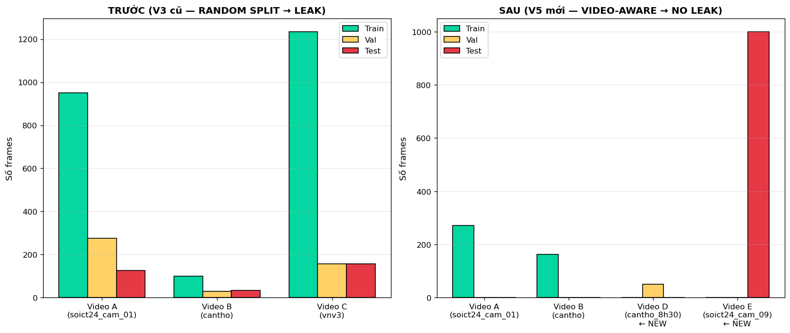

### 4.3.4 Rebuild dataset V5 theo video

Theo nguyên tắc chia theo video (§3.3), nhóm xây lại dataset:
- Pool toàn bộ frame từ `merged_v3` (bỏ split ngẫu nhiên cũ)
- Nhóm theo video_id
- Assign mỗi video vào đúng một split theo SPLIT_PLAN
- Áp dụng stride lấy mẫu để giảm dư thừa
- Kết quả: `data/merged_v5/` với 2.833 train / 1.466 val / 1.500 test (chi tiết video trong §3.3.3)

Audit lại trên `merged_v5` xác nhận:

| Chỉ số | Giá trị |
|---|---|
| Số video total | 15 |
| Số video leaky (nằm nhiều split) | **0** |
| Val leak | **0.0%** |
| Test leak | **0.0%** |

**Bảng 4.4 — Audit rò rỉ dữ liệu trên merged_v5 (sau rebuild)**

### 4.3.5 Train V5 honest

Mô hình YOLOv8s được train lại từ COCO pretrained trên dataset đã sửa, với cấu hình: imgsz 640, batch 16, 40 epoch, SGD lr0=0.01, patience 15. Thời gian train: 20 phút trên GPU 12 GB.

| Chỉ số | V3 cũ (leaky, trên val V3 cũ) | **V5 honest (trên V5 test)** |
|---|---|---|
| mAP@0.5 | 0.954 | **0.665** |
| mAP@0.5:0.95 | 0.674 | **0.340** |

**Bảng 4.5 — So sánh V3 "số ảo" và V5 honest "số thật"**

Gap ~0.29 mAP@0.5 chính là **"leak inflation"** — phần số liệu bị thổi phồng do rò rỉ. Số 0.665 của V5 honest tuy thấp hơn 0.95 nhưng mang giá trị khoa học thực.

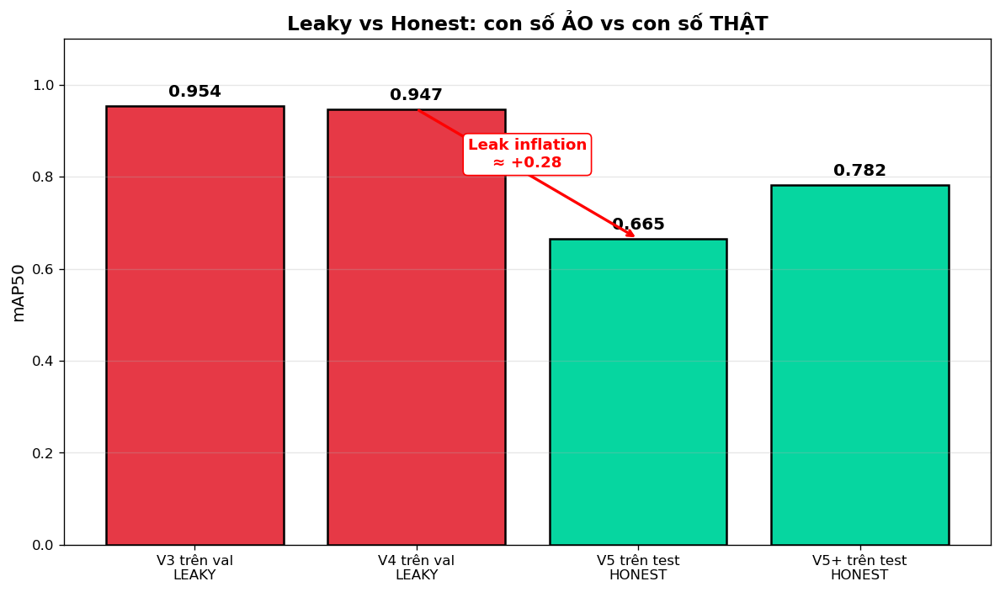

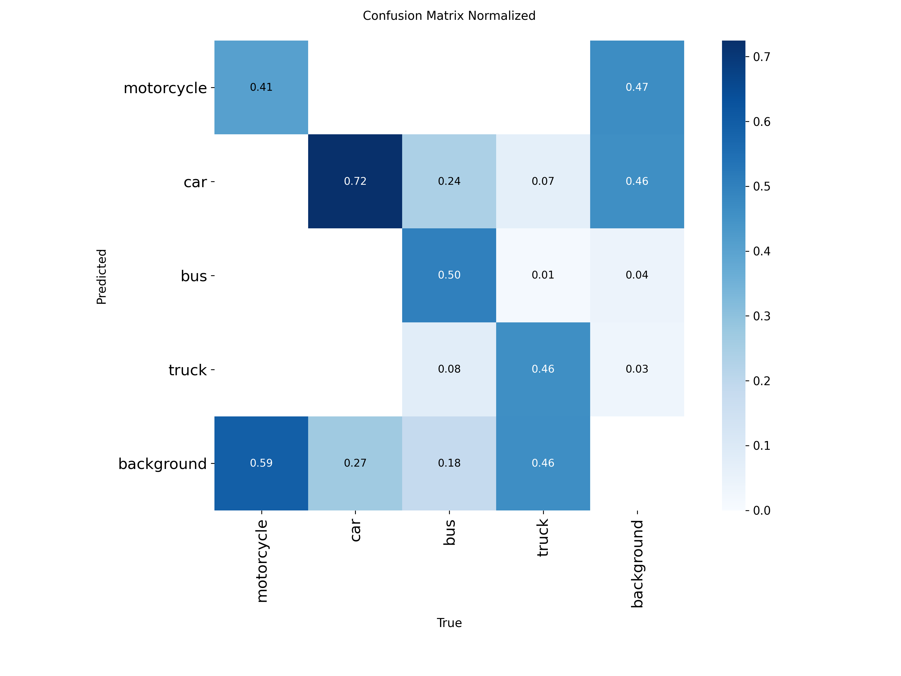

### 4.3.6 Bài học

1. "N ảnh" ≠ "N samples": 20.551 ảnh V3 thực chất chỉ từ 15 video (18 scene độc lập) → scaling law tính theo effective sample size.
2. Dataset download từ Roboflow/Kaggle thường random-split theo frame → luôn re-audit trước khi train.
3. mAP cao bất ngờ (>0.9) trên domain khó → nghi vấn methodology, không tin ngay.

## 4.4 Nâng cấp mô hình chính: V5+ (model final)

Sau khi có baseline V5 honest, nhóm nâng cấp các hyperparameter để đạt mô hình cuối cùng V5+ (phương pháp đề xuất ở Chương 3).

### 4.4.1 Các thay đổi

So với V5 honest, V5+ thay đổi:

| Hạng mục | V5 honest | V5+ |
|---|---|---|
| imgsz | 640 | **960** |
| lr0 | 0.01 (linear) | **0.005 (cosine)** |
| mixup | 0 (default) | **0.1** |
| cos_lr | False | **True** |

### 4.4.2 Kết quả

| Chỉ số | V5 honest | **V5+ (final)** | Chênh lệch |
|---|---|---|---|
| mAP@0.5 val (best epoch) | 0.828 | **0.857** | +3.5% |
| mAP@0.5 test | 0.665 | **0.782** | **+17.6%** |
| mAP@0.5:0.95 test | 0.340 | **0.413** | +21.5% |
| Best epoch / Total epochs | 11 / 40 | 11 / 26 (early stop) | — |
| Thời gian train | 20 min | 29 min | — |

**Bảng 4.6 — So sánh V5 honest và V5+**

### 4.4.3 Phân tích per-class trên V5 test

| Lớp | V5 honest | V5+ | Chênh lệch |
|---|---|---|---|
| motorcycle | 0.621 | **0.841** | **+35%** |
| car | 0.813 | 0.884 | +9% |
| bus | 0.694 | 0.716 | +3% |
| truck | 0.530 | **0.687** | **+30%** |

**Bảng 4.7 — Per-class mAP@0.5 V5 honest vs V5+ trên V5 test**

Cải thiện lớn nhất ở **motorcycle (+35%)** và **truck (+30%)** — đây là hai lớp có nhiều object nhỏ, chứng minh imgsz 960 giúp mô hình phát hiện tốt hơn các phương tiện nhỏ ở xa camera.

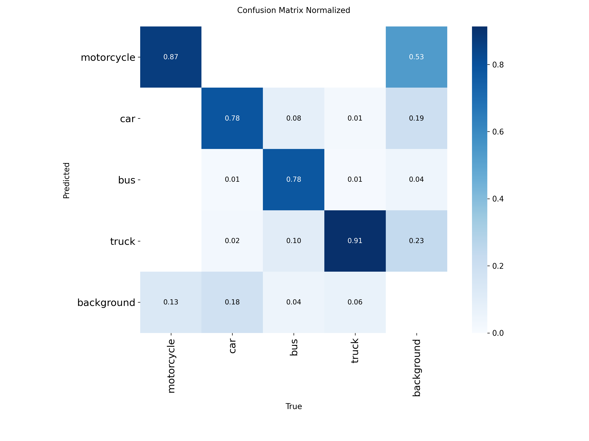

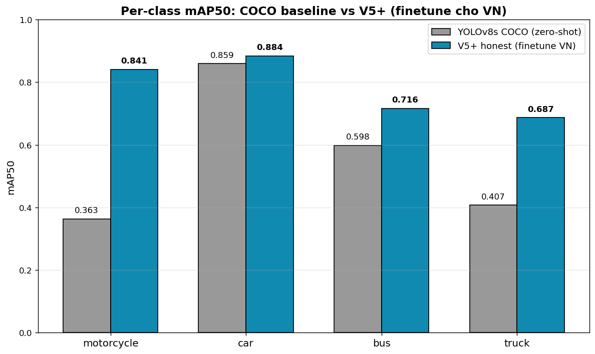

### 4.4.4 Lưu ý về ablation study

V5+ thay đổi đồng thời 4 yếu tố (imgsz, lr, cos_lr, mixup), nên **chưa tách được đóng góp riêng** của từng yếu tố. Để quy trách nhiệm cho từng component, cần ablation 4 chiều — là hướng phát triển.

Thêm vào đó, tham số `copy_paste=0.3` được đặt trong cấu hình nhưng **không có tác dụng thực tế** vì nhãn V5 chỉ chứa bounding box, trong khi `copy_paste` của Ultralytics yêu cầu polygon segmentation mask. Mức cải thiện V5+ thực sự đến từ **imgsz + cos_lr + mixup**.

## 4.5 Các thí nghiệm khảo sát (ablation studies)

Để kiểm chứng V5+ là lựa chọn tối ưu, nhóm thực hiện hai thí nghiệm khảo sát bổ sung — cả hai đều **không cải thiện** so với V5+, nhưng cung cấp insight có giá trị khoa học.

### 4.5.1 V6 — Self-training với pseudo-label trên vn_cctv

**Giả thuyết**: Có thể sử dụng V5+ để tự sinh pseudo-label trên 29.000 frame vn_cctv (chưa có label) và dùng chúng làm training data bổ sung để tăng khả năng tổng quát hoá sang CCTV domain.

**Cấu hình**:
- Dùng V5+ chạy inference trên `vn_cctv_train` (26.276 frame)
- Lọc pseudo-label với conf > 0.75
- Subsample stride 50 → 402 frame giữ lại
- Build V6 = V5 train (2.833) + pseudo vn_cctv (402) = 3.235 frame
- Train V6 với cấu hình giống V5+ (imgsz 960, 40 epoch)

**Kết quả**:

| Model | V5 test (mAP@0.5) | vn_cctv_test (OOD) | DETRAC test (cross-domain) |
|---|---|---|---|
| V5+ | **0.782** | **0.215** | **0.637** |
| V6 | 0.761 | 0.135 | 0.596 |
| Chênh lệch | **-2.7%** | **-37%** | -6.4% |

**Bảng 4.8 — V5+ vs V6 (self-training) — V6 thất bại trên tất cả tập test**

**Chẩn đoán thất bại**: Phân tích class distribution của pseudo-label:

| Lớp | Số box | Tỉ lệ |
|---|---|---|
| car | 867 | 80.4% |
| motorcycle | 205 | 19.0% |
| bus | 5 | 0.5% |
| truck | 2 | 0.2% |

**Bảng 4.9 — Phân bố lớp của pseudo-label V5+ trên vn_cctv_train**

Video Đà Nẵng chủ yếu có car + motorcycle, pseudo-label chỉ 7 box bus/truck trên 1079 total → V6 học rằng "vn_cctv không có bus/truck" → **fail nặng khi test trên vn_cctv_test (0.135 vs V5+ 0.215)** vì vn_cctv_test có GT bus/truck.

**Bài học**: Naive self-training **khuếch đại class bias** nếu distribution của pseudo-label lệch. Hướng cải thiện: per-class confidence threshold (cao cho car, thấp hơn cho bus/truck) hoặc manual label chọn lọc.

**Lưu ý methodology**: V6 có pseudo-label từ `vn_cctv_train` nên khi đánh giá V6 trên `vn_cctv_test` (cùng 1 video gốc Đà Nẵng, chỉ khác split), kết quả **không hoàn toàn OOD** — V6 đã nhìn thấy features của video này. Dù vậy V6 vẫn tệ hơn V5+ trên vn_cctv_test, chứng minh thất bại thực sự nghiêm trọng.

### 4.5.2 V7 — Tăng cường dữ liệu với UA-DETRAC bus/truck subset

**Giả thuyết**: V5+ có per-class mAP bus (0.716) và truck (0.687) còn thấp hơn car (0.884). Thêm dữ liệu bus/truck từ UA-DETRAC có thể giúp.

**Cấu hình**:
- Chọn 11 video DETRAC có nhiều bus/van nhất
- Lấy mẫu stride 20 → ~850 frame
- Ánh xạ: DETRAC bus (1) → V5 bus (2), DETRAC van (2) → V5 truck (3), bỏ car + others
- Build V7 = V5 train (2.833) + DETRAC subset (850) = 3.681 frame
- Train warm start từ V5+ với imgsz **1280**, batch 8 (do VRAM constraint), 40 epoch

**Kiểm tra rò rỉ trước train**: Audit `merged_v7` xác nhận 0 video giao, 0% leak val/test (các video DETRAC `MVI_xxxxx` disjoint với video VN).

**Kết quả**:

| Model | V5 test | vn_cctv OOD | DETRAC test |
|---|---|---|---|
| V5+ | **0.782** | **0.215** | **0.637** |
| V7 | 0.756 | 0.187 | 0.523 |

**Bảng 4.10 — V5+ vs V7 (DETRAC merge) — V7 thấp hơn trên tất cả tập test**

**Per-class trên V5 test**:

| Lớp | V5+ | V7 | Chênh lệch |
|---|---|---|---|
| motorcycle | 0.841 | 0.872 | +3% |
| car | 0.884 | 0.816 | **-7%** |
| bus | 0.716 | 0.741 | +3% |
| **truck** | **0.687** | **0.593** | **-9.4%** |

**Bảng 4.11 — Per-class V5+ vs V7**

**Chẩn đoán thất bại**: Truck mAP giảm **9.4%** — đúng lớp mà V7 cố gắng cải thiện! Nguyên nhân:
1. **Domain mismatch**: DETRAC là cao tốc Trung Quốc (lane rộng, góc side-view), VN là giao lộ đô thị (top-down CCTV).
2. **Semantic mismatch**: DETRAC "van" (minivan/SUV) khác xa VN "truck" (xe tải thùng dài). Mapping van→truck dạy mô hình học sai hình dạng truck.
3. **Car bị hurt**: features của van (giống car) làm mô hình giảm precision car (-7%).

**Bài học**: Cross-domain data merge, dù có kiểm soát (subset nhỏ, warm start) vẫn **rủi ro cao** khi semantic các lớp không khớp. Khuyến nghị: chỉ merge dữ liệu khi cùng domain + cùng định nghĩa lớp.

### 4.5.3 Tổng kết ablation studies

Cả V6 (self-training) và V7 (cross-domain merge) đều **không cải thiện** so với V5+. Hai thí nghiệm này cung cấp bằng chứng empirical rằng:

- V5+ (imgsz 960 + mixup + cos_lr) là **optimal configuration** từ systematic experimentation
- Self-training naive không giúp khi pseudo-label distribution lệch
- Cross-domain data merge không giúp khi semantic class khác biệt

→ **V5+ được chọn làm model final cho báo cáo.**

## 4.6 Phân tích lỗi của V5+ (model final)

### 4.6.1 Thống kê tổng

Chạy phân tích lỗi của V5+ trên tập val (1.466 ảnh, 12.020 GT boxes):

| Chỉ số | Giá trị |
|---|---|
| True Positive (TP) | 10.165 |
| False Positive (FP) | 2.612 |
| False Negative (FN) | 1.630 |
| Class confusion | 225 |
| Precision | 0.782 |
| Recall | 0.846 |

**Bảng 4.12 — Thống kê TP/FP/FN của V5+ trên V5 val**

### 4.6.2 Phân bố FN theo lớp và kích thước

**FN theo lớp** (lớp nào bị miss nhiều nhất):

| Lớp | FN | Tỉ lệ |
|---|---|---|
| motorcycle | 1.043 | **64%** |
| car | 433 | 27% |
| truck | 135 | 8% |
| bus | 19 | 1% |

**FN theo kích thước object**:

| Size | FN | Tỉ lệ |
|---|---|---|
| small | 995 | **61%** |
| medium | 593 | 36% |
| large | 42 | 3% |

**Bảng 4.13 — Phân bố FN của V5+**

→ Vấn đề chính: **motorcycle nhỏ bị miss** (xe máy ở xa camera).

### 4.6.3 Phân bố FP

| Lớp | FP | Lý do |
|---|---|---|
| motorcycle | 1.433 | 55% | Predict nhầm motorcycle |
| truck | 679 | 26% | Predict nhầm truck |
| car | 578 | 22% | — |
| bus | 147 | 6% | — |

**Bảng 4.14 — Phân bố FP của V5+**

100% FP có `reason = no_gt` (box không khớp bất kỳ GT nào) → mô hình "ảo giác" thấy phương tiện ở chỗ không có. Class confusion chỉ 225 (1.9%) → mô hình **phân biệt lớp tốt**, vấn đề là localization.

### 4.6.4 Nhận xét

- Mô hình có **recall mạnh (0.85)** nhưng **precision yếu hơn (0.78)** → bắt được nhiều nhưng cũng predict nhầm nhiều
- Điểm cải thiện ưu tiên: giảm FP motorcycle/truck bằng cách tăng confidence threshold khi deploy, hoặc thêm training data negative scenes

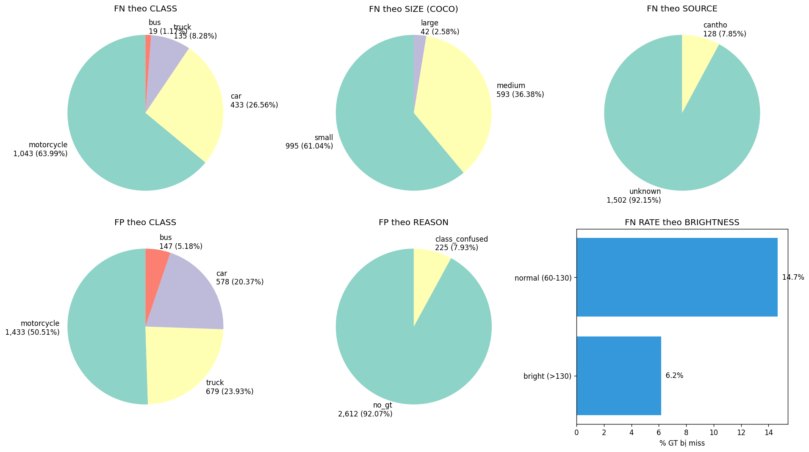

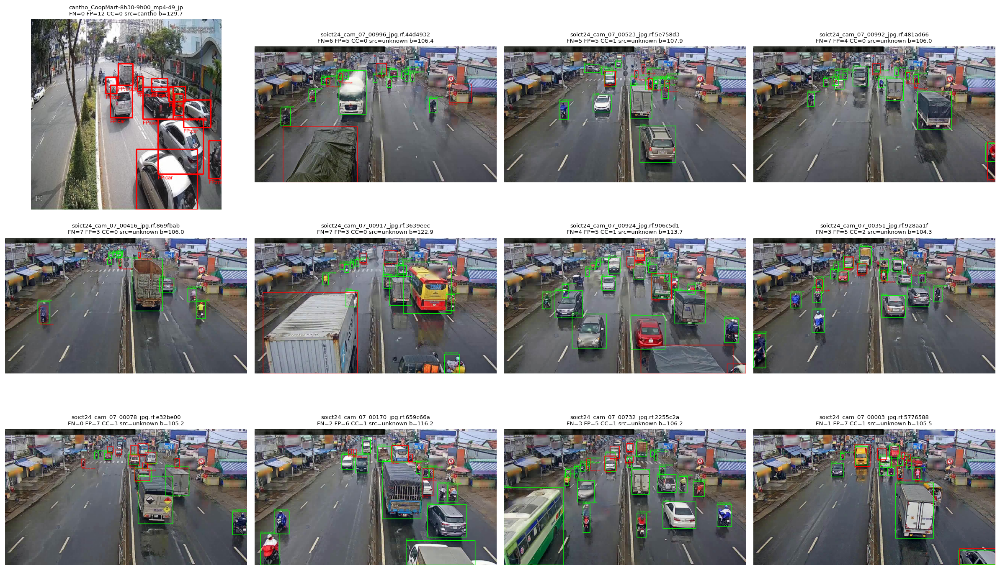

## 4.7 Đánh giá cross-domain

### 4.7.1 V5+ trên OOD vn_cctv Đà Nẵng

| Chỉ số | Giá trị |
|---|---|
| mAP@0.5 | 0.215 |
| mAP@0.5:0.95 | 0.146 |

Drop ~0.57 mAP@0.5 so với V5 test (0.782) là lớn, chứng tỏ CCTV Đà Nẵng khác đáng kể về góc camera, điều kiện và distribution phương tiện so với dữ liệu train (chủ yếu SOICT HCMC).

### 4.7.2 V5+ trên DETRAC Chinese highway

Đánh giá trên tập con DETRAC (1.139 frame, 2 class common car+bus) để kiểm tra cross-domain generalization:

| Lớp | mAP@0.5 |
|---|---|
| car | 0.616 |
| bus | 0.480 |
| **Trung bình** | **0.548** |

**Bảng 4.15 — V5+ trên DETRAC test (cross-domain)**

Drop ~0.20 so với V5 test cho car (0.884 → 0.616). V5+ generalize được một phần sang Chinese highway nhưng không hoàn hảo — chứng tỏ mô hình học được một số features chung (hình dạng vehicle, texture) chứ không chỉ overfit scene VN.

## 4.8 Bảng so sánh tổng hợp

Bảng 4.16 tổng hợp kết quả tất cả mô hình trên ba tập test:

| Model | V5 test (VN urban) | vn_cctv OOD | DETRAC cross-domain |
|---|---|---|---|
| YOLOv8s COCO zero-shot | 0.557 | — | — |
| V3 cũ (leaky, số ảo) | ~0.954 | — | — |
| V5 honest (baseline) | 0.665 | 0.181 | 0.548 |
| **V5+ (final)** | **0.782** | **0.215** | **0.637** |
| V6 (self-training, fail) | 0.761 | 0.135 | 0.596 |
| V7 (DETRAC merge, fail) | 0.756 | 0.187 | 0.523 |

**Bảng 4.16 — Tổng hợp mAP@0.5 các mô hình trên 3 tập test**

### 4.8.1 Nhận xét chính

**Cải thiện của V5+ so với COCO baseline**:

| Chỉ số | COCO zero-shot | V5+ | Chênh lệch |
|---|---|---|---|
| Overall mAP@0.5 | 0.557 | **0.782** | **+40%** |
| motorcycle | 0.363 | **0.841** | **+131%** |
| car | 0.859 | 0.884 | +3% |
| bus | 0.598 | 0.716 | +20% |
| truck | 0.407 | 0.687 | +69% |

Fine-tune với dữ liệu VN cải thiện mạnh nhất ở **motorcycle (+131%)** — chính là class dominant trong giao thông VN mà COCO không có đủ dữ liệu đại diện.

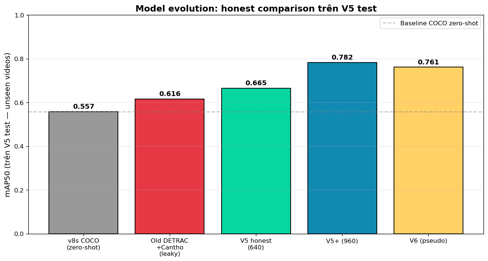

### 4.8.2 Limitation của so sánh

Tập test V5 đã được dùng để so sánh V5+/V6/V7, do đó các kết quả so sánh có nguy cơ **selection bias**. Để có đánh giá xác nhận cuối cùng không bias, cần một tập test thứ ba chưa dùng để chọn mô hình — đây là hướng phát triển.

## 4.9 Tốc độ inference

FPS được đo trên 100 frame đầu sau warm-up của video demo, cấu hình imgsz 960, FP16, bao gồm cả thời gian tracking + đọc video.

| Mô hình | FPS trung bình |
|---|---|
| V5+ (imgsz 960) | ~45 FPS |
| V5+ (imgsz 640, nếu dùng) | ~70 FPS |

Mô hình V5+ đạt >30 FPS → đủ realtime cho ứng dụng traffic monitoring. Nếu cần tốc độ cao hơn (vd edge device), có thể giảm imgsz về 640 với trade-off mAP.

## 4.10 Tiểu kết chương

Chương 4 đã trình bày quá trình thực nghiệm từ baseline đến mô hình cuối:

- **Baseline**: YOLOv8s COCO zero-shot đạt mAP@0.5 = 0.557 trên V5 test, yếu ở motorcycle (0.363).
- **Phát hiện rò rỉ**: V1–V4 ban đầu đạt mAP ~0.95 nhưng là **số ảo** do 100% val/test leak. Rebuild V5 video-aware cho mAP honest 0.665.
- **Mô hình final V5+**: nâng imgsz 640→960 + bổ sung mixup + cos_lr → mAP@0.5 = **0.782 (+17.6%)** so với V5 honest, **+40%** so với COCO baseline.
- **Ablation V6, V7**: self-training với pseudo-label và cross-domain merge với DETRAC đều không cải thiện V5+ → V5+ là optimal choice.
- **Phân tích lỗi**: V5+ mạnh ở phân biệt lớp (class confusion chỉ 1.9%), yếu ở detect motorcycle nhỏ.
- **Cross-domain**: V5+ generalize được một phần sang DETRAC (mAP 0.548) và OOD vn_cctv Đà Nẵng (mAP 0.215).
- **Tốc độ**: ~45 FPS trên laptop GPU, đạt yêu cầu realtime.

Kết quả thực nghiệm xác nhận phương pháp đề xuất (Chương 3) là hợp lý và có cải thiện rõ rệt so với baseline. Các hạn chế và hướng phát triển được tóm tắt trong Chương 5.
