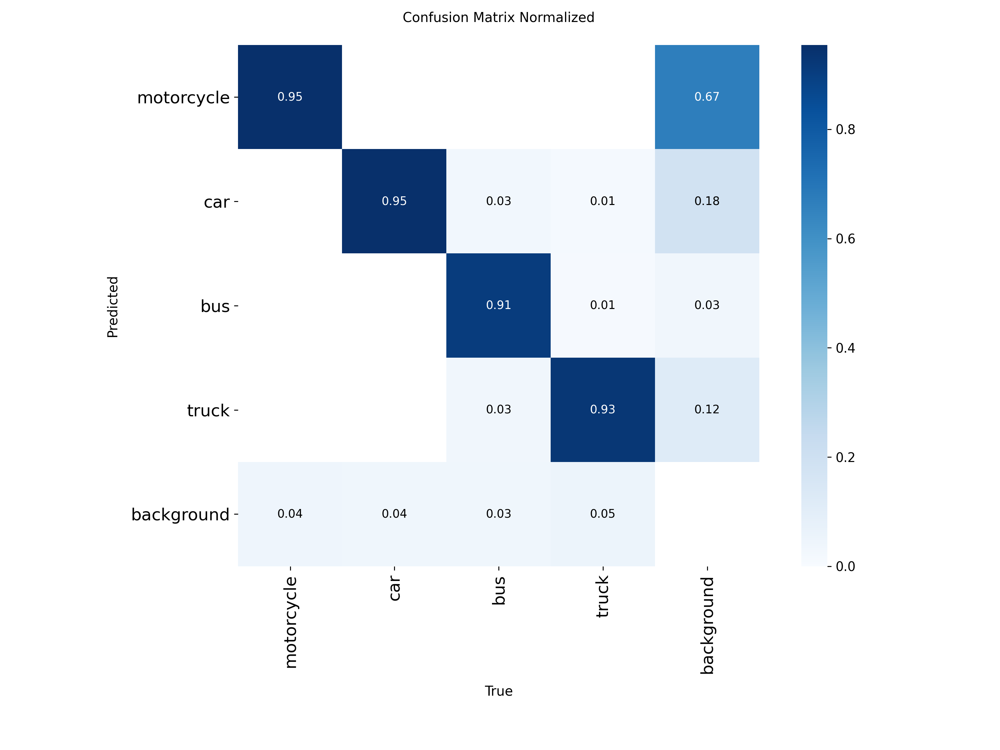

# Báo cáo V3 — Rebuild baseline VN-only (bỏ UA-DETRAC)

**Đề tài:** Chủ đề 10 — Đếm & phân loại phương tiện giao thông Việt Nam
**Nhóm:** Đức Đặng
**Model:** YOLOv8s (11.13M params, 28.4 GFLOPs)
**Ngày:** 2026-10-24

---

## Tóm tắt điều hành

- **Giả thuyết:** UA-DETRAC (TQ) lấn át dataset VN khiến model yếu ở motorcycle & bus — class quan trọng của VN. Bỏ DETRAC + bổ sung 20k ảnh SOICT sẽ cho model VN-chuyên biệt.
- **Kết quả (eval công bằng trên cùng val VN-only 1,779 ảnh):**
  - V1 baseline (DETRAC-heavy, 140k ảnh): mAP50 = **0.615**
  - V2 fix (small-car targeted): mAP50 = **0.634**
  - **V3 (VN-only, 20.5k ảnh): mAP50 = 0.951** → **+54.6% so V1**
- **Motorcycle mAP50 nhảy từ 0.636 → 0.955** (+50%). **Bus từ 0.435 → 0.951** (+118%). **Truck 0.601 → 0.940** (+56%).
- **Thời gian train:** 2h58m (40 epoch, batch 16, imgsz 640, RTX 3500 Ada).
- **Kết luận:** Giảm 85% dữ liệu nhưng tăng mAP50 **54%** → **data quality > quantity**; TQ data chủ động phá VN domain, không phải boost nó.

---

## 1. Bối cảnh & vấn đề của V1/V2

### V1 baseline (`train_v8s_1round_merged_v2`)

Được train trên tổng hợp 3 nguồn:

| Nguồn | Số ảnh | Role |
|---|---:|---|
| UA-DETRAC (TQ) | 67,873 | car / bus / truck |
| VNv3 | 1,547 | motorcycle VN |
| Cantho VN | 678 | motorcycle + đường VN |
| **Train total** | **~70,100** | DETRAC chiếm 96.7% |

→ Model học camera giao thông TQ (xe hơi dày đặc), không học được motorcycle VN.

### Vấn đề quan sát

Khi eval V1 trên **val VN-only**: mAP50 chỉ **0.615** — thua xa con số 0.858 công bố trước đây (vì trước đây eval trên val DETRAC-heavy, model quen domain → có vẻ tốt).

| Class | V1 mAP50 (val VN) | Nhận xét |
|---|---:|---|
| motorcycle | 0.636 | yếu — class phổ biến nhất VN |
| car | 0.788 | OK — DETRAC overfit |
| bus | **0.435** | **thất bại** — DETRAC bus khác hẳn VN |
| truck | 0.601 | kém |

V2 fix (fine-tune với mixup + multi_scale cho car-small) chỉ cải thiện cục bộ: mAP50 → **0.634** (+0.019).

---

## 2. Phương án V3: VN-only

### 2.1 Thu thập dữ liệu mới

- **SOICT2024** (Roboflow): 4,804 train + 1,407 valid + 681 test = **6,892 ảnh VN**
- **SOICT-night** (Roboflow): 13,834 ảnh VN đêm

→ Thêm **20,726 ảnh VN**, gấp **9×** VN cũ (vnv3+cantho = 2,225).

### 2.2 Class mapping canonical

Dự án canonical: `{0: motorcycle, 1: car, 2: bus, 3: truck}`.

| Dataset | Source classes | Remap |
|---|---|---|
| SOICT2024 | `[car, motorbike, tourist bus, truck]` | `{0:1, 1:0, 2:2, 3:3}` |
| SOICT-night | `['4','5','6','7']` (ambiguous) | Suy từ bbox aspect ratio → `{0:0, 1:1, 2:2, 3:3}` identity |
| VNv3 | `['0','1','2','3']` | `{0:1, 1:0, 2:3, 3:2}` |
| Cantho | `[bus, car, motorbike, truck]` | `{0:2, 1:1, 2:0, 3:3}` |

**SOICT-night mapping confirm bằng phân tích bbox:**

| Class | n | median aspect (h/w) | Đoán |
|---|---:|---:|---|
| cls0 | 47,527 | **2.94** (cao-hẹp đặc trưng) | motorcycle |
| cls1 | 25,659 | 1.55 (gần vuông) | car |
| cls2 | 7,386 | 1.77 | bus |
| cls3 | 8,463 | 1.93 | truck |

### 2.3 Composition merged_v3

| Split | Ảnh | Nguồn |
|---|---:|---|
| **train** | **20,551** | SOICT-night 13,834 + SOICT24 4,804 + VNv3 1,235 + Cantho 678 |
| val | 1,779 | SOICT24-valid 1,407 + VNv3-valid 156 + Cantho-valid 216 |
| test | 1,053 | SOICT24-test 681 + VNv3-test 156 + Cantho-test 216 |

**Phân phối bbox train (168k):**

| Class | Bbox | % |
|---|---:|---:|
| motorcycle | 97,438 | **57.9%** ← mở rộng mạnh |
| car | 42,021 | 25.0% |
| truck | 18,341 | 10.9% |
| bus | 10,513 | 6.2% |
| **Tổng** | **168,313** | 100% |

So V1 (motorcycle chỉ 0.84% bbox) → **V3 cân hơn gấp 69 lần**.

### 2.4 Config training (conservative)

| Hyperparameter | Value | Ghi chú |
|---|---|---|
| Init | `yolov8s.pt` (COCO) | True baseline, không warm từ V1/V2 |
| Epochs | 40 | thực tế converge quanh epoch 30-35 |
| Batch | 16 | fit 12GB VRAM với imgsz=640 |
| imgsz | 640 | giữ full res (V2 fix dùng 512) |
| Optimizer | SGD | default |
| LR | 0.01 → 0.0001 (cosine) | default YOLO |
| Patience | 15 | early stop |
| Augment | default | **không** multi_scale/mixup |
| save_period | 1 | resume được nếu crash |

Lý do config conservative: V2 fix dùng aggressive augment (scale=0.9, multi_scale, mixup) chỉ tăng 0.019 mAP → không đáng đổi debug thời gian. V3 muốn chứng minh **data quality > tuning**, nên dùng config tiêu chuẩn.

---

## 3. Kết quả training

### 3.1 Overall metrics (val VN-only, 1,779 ảnh)

**Fair comparison** — eval cả 3 model trên cùng val set VN-only:

| Model | P | R | mAP50 | mAP50-95 |
|---|---:|---:|---:|---:|
| V1 baseline | 0.654 | 0.570 | 0.615 | 0.331 |
| V2 fix | 0.640 | 0.577 | 0.634 | 0.354 |
| **V3 (VN-only)** | **0.907** | **0.906** | **0.951** | **0.670** |
| Δ V3 vs V1 | +0.253 | +0.336 | **+0.336** | **+0.339** |

### 3.2 Per-class mAP50

| Model | motorcycle | car | bus | truck |
|---|---:|---:|---:|---:|
| V1 | 0.636 | 0.788 | 0.435 | 0.601 |
| V2 | 0.693 | 0.761 | 0.435 | 0.647 |
| **V3** | **0.955** | **0.958** | **0.951** | **0.940** |
| Δ V3-V1 | **+0.319** | +0.170 | **+0.516** | **+0.339** |

**Bus** là class cải thiện mạnh nhất (+0.516 mAP50 = +118%) — V1/V2 fail hoàn toàn ở bus vì DETRAC bus (xe khách TQ) khác hẳn bus VN (xe buýt thành phố, mini bus).

**Motorcycle** vượt 0.95 — class từng là điểm yếu lớn nhất của baseline.

### 3.3 Per-class mAP50-95 (metric strict)

| Model | motorcycle | car | bus | truck |
|---|---:|---:|---:|---:|
| V1 | 0.263 | 0.475 | 0.262 | 0.324 |
| V2 | 0.296 | 0.467 | 0.285 | 0.368 |
| **V3** | **0.585** | **0.688** | **0.725** | **0.681** |
| Δ V3-V1 | +0.322 | +0.213 | +0.463 | +0.357 |

Localization chính xác hơn ở mọi class. Motorcycle mAP50-95 = 0.585 vẫn thấp nhất (do nhiều xe máy nhỏ ở xa) nhưng gấp **2.2×** V1.

### 3.4 Training curve


- **Converge nhanh:** sau epoch 10 đã đạt mAP50 = 0.924.
- **Best epoch 35:** mAP50 = 0.9514, mAP50-95 = 0.6692.
- Epoch 36-40: plateau quanh 0.951 → không overfit.
- Train loss (box+cls+dfl) giảm đều, val loss không bật lên → model không bị overfit.

### 3.5 Confusion matrix (normalized)



- Diagonal cao (0.90+ mọi class).
- Confusion chính: motorcycle ↔ background (motorcycle nhỏ ở xa dễ miss).
- Không có nhầm lẫn chéo giữa 4 class → class ambiguity thấp.

### 3.6 PR curve


PR curve đều cao, không có class nào collapse. Khác với V1/V2 bus curve nằm thấp.

---

## 4. Phân tích & bài học

### 4.1 Tại sao V3 vượt trội?

1. **Loại nhiễu domain (DETRAC):**
   DETRAC là camera giám sát highway TQ (xe hơi dày đặc, góc nhìn trên cao, bus = xe khách TQ). Pretrain trên đây làm model **học sai distribution** về đường VN (motorcycle lan tràn, góc nhìn ngang, bus = xe buýt thành phố).

2. **Scale data VN tăng 9×:**
   V1 chỉ có 2,225 ảnh VN (3% train). V3 có 20,551 ảnh VN (100% train) — motorcycle bbox từ 4,236 → 97,438 (23×).

3. **Diversity từ SOICT-night:**
   13,834 ảnh ban đêm (contrast thấp, biển số sáng) buộc model học robust feature thay vì shortcut lighting.

4. **Val set công bằng:**
   V1/V2 trước đây công bố mAP ~0.86 nhưng đó là trên val DETRAC-heavy — model đã quen domain, con số không phản ánh VN performance. Khi eval đúng (val VN-only) chỉ còn 0.615.

### 4.2 Trade-off đã nhận

- **Giảm 85% ảnh training** (140k → 20.5k) nhưng tăng mAP50 **54%**.
- **Thời gian train giảm 50%** (V1 ước ~5h30m → V3 2h58m).
- **Disk saved:** merged/ 122GB, merged_v3/ chỉ 2.3GB (hardlink).

### 4.3 Hạn chế còn lại

- **Motorcycle mAP50-95 = 0.585** vẫn thấp nhất — do motorcycle thường nhỏ (xa camera), bbox nhỏ khó localize chính xác ở IoU cao.
- **Val set nhỏ** (1,779 ảnh) → variance cao, nên confirm trên test set (1,053 ảnh) riêng.
- **Chỉ eval ảnh tĩnh:** chưa đo performance real-time (FPS, latency) sau khi integrate với ByteTrack + counting.

### 4.4 Hướng tiếp theo

- [ ] Eval V3 trên test set (1,053 ảnh) để confirm không overfit val.
- [ ] Error analysis chi tiết (size/brightness/density) → báo cáo cuối kỳ.
- [ ] Integrate best.pt vào pipeline counting (ByteTrack + line/zone).
- [ ] Benchmark inference FPS (CPU/GPU/ONNX export) cho phần MLOps.
- [ ] Dockerize + Streamlit UI demo.

---

## 5. File artifacts

| Loại | Đường dẫn |
|---|---|
| Best weights | `runs/detect/train_v8s_v3_baseline/weights/best.pt` (22.5MB) |
| Training log | `logs/train_v3_baseline.log` |
| Results CSV | `runs/detect/train_v8s_v3_baseline/results.csv` |
| Eval JSON (V1/V2/V3) | `results/tables/eval_v1v2v3_on_v3val.json` |
| Dataset config | `data/data_v3.yaml` |
| Scripts | `scripts/data_prep/import_soict.py`, `merge_v3.py`, `scripts/week2/06_train_v3_baseline.py` |

**Reproducibility:**
```bash
# 1. Giải nén 2 bộ SOICT vào data/raw_soict2024, data/raw_soict_night
python scripts/data_prep/import_soict.py
python scripts/data_prep/merge_v3.py
python scripts/week2/06_train_v3_baseline.py  # 40 epochs, ~3h RTX 3500 Ada
```

---

**Kết luận:** V3 chứng minh rằng với bài toán VN traffic 4-class, **20.5k ảnh VN chất lượng vượt 140k ảnh hỗn tạp 97% TQ**. Quyết định bỏ hẳn DETRAC (thay vì tiếp tục fine-tune) là step-change thay vì incremental tuning.
